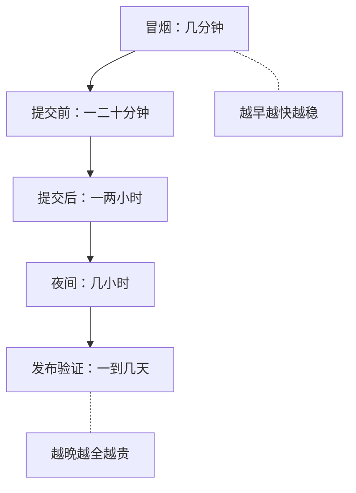

## Q
面试里被问"一个团队的测试要分几档、每档放什么"，怎么答？

## A
- **先说原则**：越早的档越快越稳，越晚的档越全越贵；每档有时间预算和明确的失败处理方式。
- **说五档和预算**：冒烟几分钟只看能不能用；提交前一二十分钟挡住明显回归；提交后一两小时覆盖慢集成和小规模硬件；夜间几小时跑全组合、性能和短长稳；发布验证一到几天对发布候选跑完整回归、长稳、故障注入和门限。

- **说怎么分配测试**：看单条耗时、flaky 率、是否需要稀缺硬件、历史上抓回归的价值；不稳定的先修稳再晋升；用 pytest 标记加 `-m` 选择让各流水线跑各自的档。
- **说失败怎么处理**：提交前由作者修；提交后先回滚再查因；夜间第二天分诊并二分；发布验证进阻断项分诊。
- **说怎么调整**：盯三个指标：提交前耗时、主干红灯时长、"本该在提交前抓到却在提交后才抓到"的回归比例，据此把测试往前或往后挪。
- **补一句取舍**：把所有测试都塞进提交前看似安全，实际上会因为排队和 flaky 被绕过，反而更不安全。
