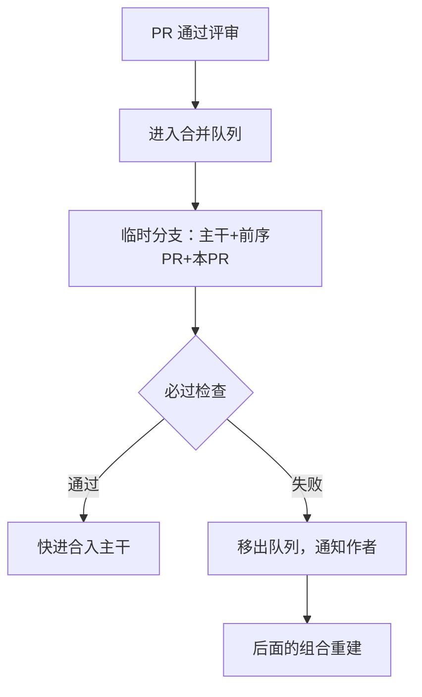

## Q
合并队列（merge queue）是怎么工作的？它解决了什么问题？GitHub 的合并队列在 CI 里需要做什么配置？

## A
**问题**：PR 的测试是在"PR + 当时的主干"上跑的。等它合入时，主干可能已经前进了好几个提交，PR 实际进入的组合从来没被测过。

**合并队列的做法**：PR 通过评审后不直接合入，而是进队列。队列为每个 PR 构造"最新主干 + 排在它前面的所有 PR + 它自己"这个组合，在这个组合上跑必过检查，通过才真正合入。这就是"不是火箭科学规则"（not rocket science rule）：主干只接受测过的那个确切状态。

**投机执行（speculative）**：队列不必等前一个 PR 测完才测下一个。PR1 测"主干+1"，同时 PR2 测"主干+1+2"，PR3 测"主干+1+2+3"。都通过就依次合入；PR1 失败，后面的组合都要去掉 1 重建。

**GitHub 合并队列的配置要点**：
- 在分支保护规则里开启合并队列；
- GitHub Actions 的工作流必须加 `on: merge_group` 触发，否则队列里的检查不会报告结果，合并会一直失败；第三方 CI 则监听推送到 `gh-readonly-queue/<目标分支>/...` 临时分支的事件；
- 可配置并发构建数（1–100）、一次合入的最少 / 最多 PR 数、等待时间。

**同类工具**：GitLab 的合并列车（merge trains）、Bors、Zuul 的投机门控。
