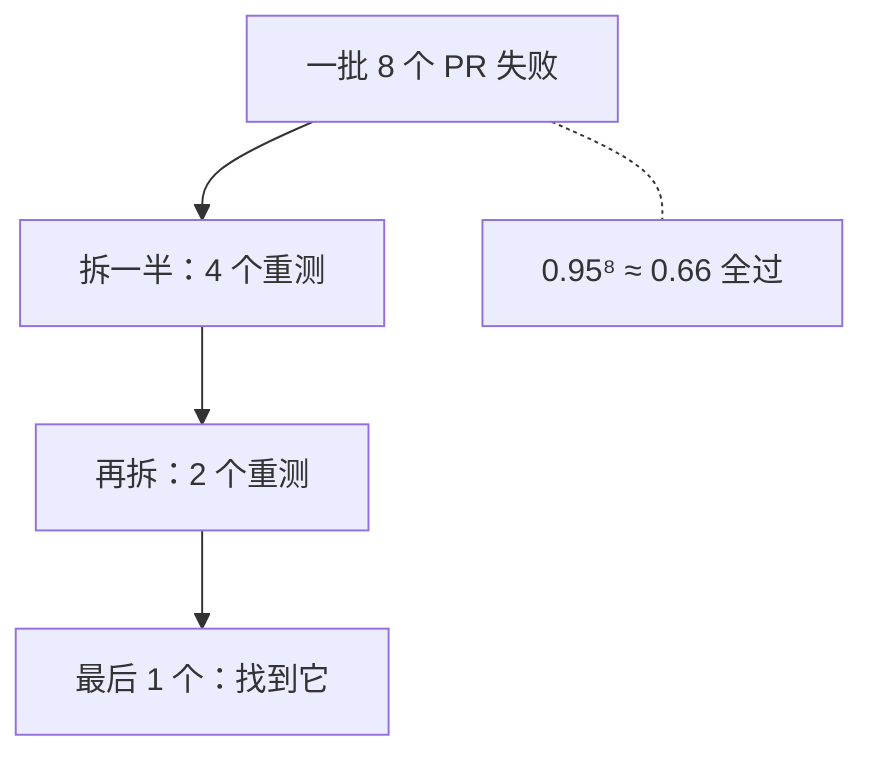

## Q
合并队列的检查要跑 30 分钟，每天有 200 个 PR 要合入。队列能跟得上吗？批量合入和 flaky 测试会带来什么问题？用数字算。

## A
**不并行、一次一个**：每个 PR 30 分钟，一天 24 小时最多 48 个，远不够 200 个。

**批量合入**：一次把 8 个 PR 组成一批，在"主干 + 8 个 PR"上跑一次检查，通过就一起合入。
- 每批 30 分钟，一天最多 48 批 × 8 = 384 个，够用。
- 代价：一批失败时不知道是哪个 PR 的问题。要么在这一批里二分：每次把嫌疑 PR 对半拆开重测（8 个 PR 最多再跑 3 轮：8 → 4 → 2 → 1），要么把它们拆开逐个重测。

**失败率决定批量的效果**：设每个 PR 单独会失败的概率是 p = 5%。
- 一批 8 个全部没问题的概率 = 0.95⁸ ≈ 0.66，也就是约三分之一的批次会失败，需要额外二分。
- 一批 16 个：0.95¹⁶ ≈ 0.44，过半批次失败，批越大越不划算。
- 所以失败率高时批要小，失败率低时批可以大。

**flaky 测试是合并队列的大敌**：设检查里的 flaky 测试让一次运行无故失败的概率是 2%。
- 每次误失败会把整批（或一个 PR）踢出队列，后面的投机组合全部重建，浪费的是整条队列的时间；
- 一天 48 批，平均约 1 批被误踢，被踢的作者还会去查一个不存在的问题。

**对策**：
- 队列里只放稳定的检查，flaky 测试隔离出去；
- 失败的批次先对失败的测试快速重跑一次，确认可复现再踢人（重跑结果要记录）；
- 投机执行：多个批次同时在测，提高吞吐，但要更多 CI 机器；
- 慢的硬件测试不进队列，放到提交后，用回滚兜底。

一句话：合并队列的吞吐 ≈ 并发数 × 批大小 ÷ 检查时长，而检查越慢、越不稳定，能用的批就越小。
