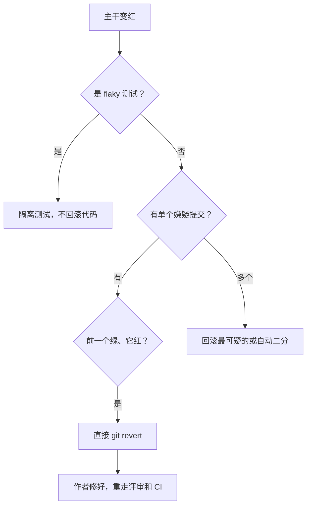

## Q
"先回滚、再查因"（revert first）规则是什么？为什么主干变红时不让作者"马上修一下"？用数字说明红主干的代价。

## A
**规则**：主干上的提交后测试变红，并且能指向一个嫌疑提交时，值班的人直接回滚（`git revert`）它，不需要作者同意；作者事后修好，重新走完整评审和 CI 再合入。

**为什么不等"马上修"**：
- **修复的时间不可预测**："五分钟就好"经常变成两小时：第一个修复不对、修复本身又要排队跑 CI。回滚是已知安全的操作，因为它回到了一个测过的状态。
- **红主干的代价是全团队在付**：
  - 例：100 个工程师共用主干，红了 3 小时。在这期间每个人的提交前测试都可能因为同一个问题失败，或者大家停止合入。即使只有三分之一的人受影响、每人损失 1 小时，也是约 33 小时，四人天以上。
  - 红灯期间合入的其他提交，没法确认它们自己是不是也引入了问题，"红上加红"后定位成本成倍增加。
- **回滚不是惩罚**：它只是把"修复"从全团队的关键路径上挪到作者自己的时间里。

**执行要点**：
- **嫌疑要有证据**：在嫌疑提交和它前一个提交上各跑一次失败的测试，前绿后红才回滚；
- **回滚提交写明原因**：失败的测试、日志链接、通知作者；
- **回滚也要过 CI**，但走快速通道，优先排队；
- **找不到单个嫌疑时**（同一时段多个提交）：先回滚最可疑的，或对这段区间做自动二分（在提交区间里反复取中点测试，找出引入问题的那个提交）；
- **flaky 测试导致的红**不回滚产品代码，而是隔离那条测试。

**度量**：从主干变红到恢复绿色的时间（中位数和 p90），目标以小时甚至分钟计。
