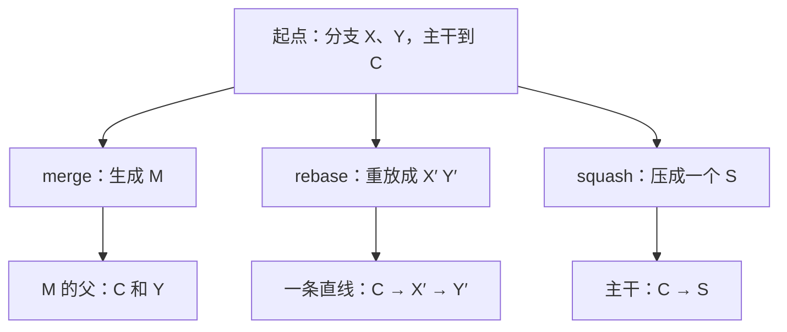

## Q
`git merge`、`git rebase` 和 squash 合并分别对历史做了什么？在团队里各在什么时候用？

## A
设功能分支从主干的提交 B 分出，分支上有提交 X、Y；同时主干前进到了 C。

- **merge**（`git merge feature`）：生成一个新的合并提交 M，它有两个父提交 C 和 Y。原有提交一个不改，历史呈分叉再汇合的形状。
  - 优点：真实记录发生了什么；不改写任何已有提交，对共享分支安全。
  - 缺点：历史里很多合并提交，读起来乱；`--no-ff` 强制生成合并提交，便于整体回滚一个功能。
- **rebase**（`git rebase main`）：把 X、Y 拿下来，在 C 之后重新"重放"一遍，得到 X′、Y′。内容相同，但提交哈希变了，历史是一条直线。
  - 优点：线性历史，二分（bisect，在提交区间里反复取中点测试，找出引入问题的那个提交）和阅读都简单。
  - 缺点：改写了提交。**已经推送、别人基于它工作的分支不要 rebase**，否则别人的历史和你的对不上。
- **squash 合并**（`git merge --squash` 或代码平台的 "Squash and merge"）：把 X、Y 压成主干上的一个新提交。
  - 优点：主干上一个改动一个提交，回滚（revert）一个改动只要回滚一个提交；二分时每一步都是完整、可构建的改动。
  - 缺点：分支内部的细节历史丢失；大改动压成一个提交后难以细分定位。

**常见团队约定**：
- 自己的功能分支上，用 `git rebase main` 跟上主干、`git rebase -i` 整理提交；
- 合入主干用 squash 或 rebase，保持主干线性，每个提交都能单独构建和测试；
- 发布分支和其他共享长期分支之间用 merge 或 cherry-pick，从不 rebase。

**冲突处理**：rebase 时冲突逐个提交解决（`git rebase --continue`），merge 时一次解决。解决冲突是在写新代码，解决完必须重新跑测试，而不是只看能不能编译。
