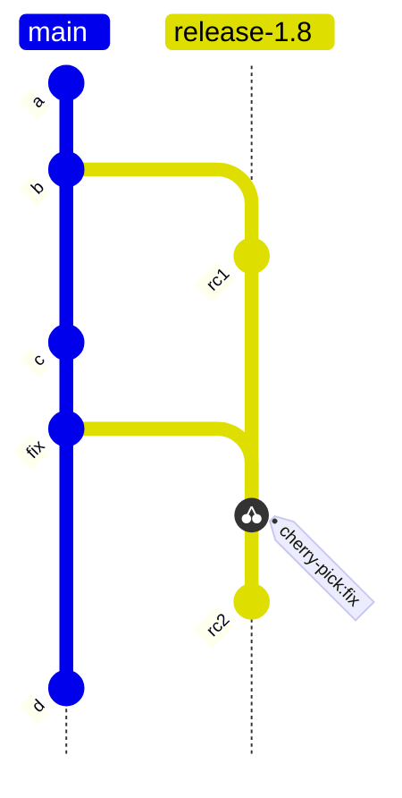

## Q
主干开发（trunk-based development）、发布分支（release branch）和 git-flow 三种分支模型分别是怎样的？各适合什么团队？

## A
- **主干开发**：所有人每天直接（或经过很短命的分支）合入主干 `main`，主干永远保持可发布。没做完的功能藏在功能开关（feature flag）后面。适合持续部署的在线服务：每次合入都可能直接上线。
- **主干开发 + 发布分支**：日常开发仍在主干；到发布时间从主干切出 `release/1.8`，这个分支只接受修复，稳定后从它发布。主干继续往前走。适合有版本号、要给用户打补丁的产品：编译器、运行时、SDK、需要客户安装的软件。
- **git-flow**：长期存在 `develop`（集成）和 `master`（只放已发布版本）两条分支，另有 `feature/*`、`release/*`、`hotfix/*`。功能分支可能活几周。规则多，合并多，适合发布很少、版本很正式的项目；如今多数团队认为它对持续集成不友好。

上图是"主干 + 发布分支"：修复先进主干，再挑拣（cherry-pick）到发布分支，打出第二个发布候选 `rc2`。

**选择依据**：
- 能不能随时从主干发布？能 → 纯主干开发。
- 要不要同时维护多个已发布版本？要 → 必须有发布分支。
- 集成频率：分支活得越久，合回来时的冲突和跨组件问题越多。无论哪种模型，**功能分支都应以天计，而不是以周计**。

一个多组件软件栈（编译器、运行时、固件一起发布）通常选"主干 + 定期切发布分支"：主干保持高速集成，发布分支给验证留出一个不再变动的目标。
