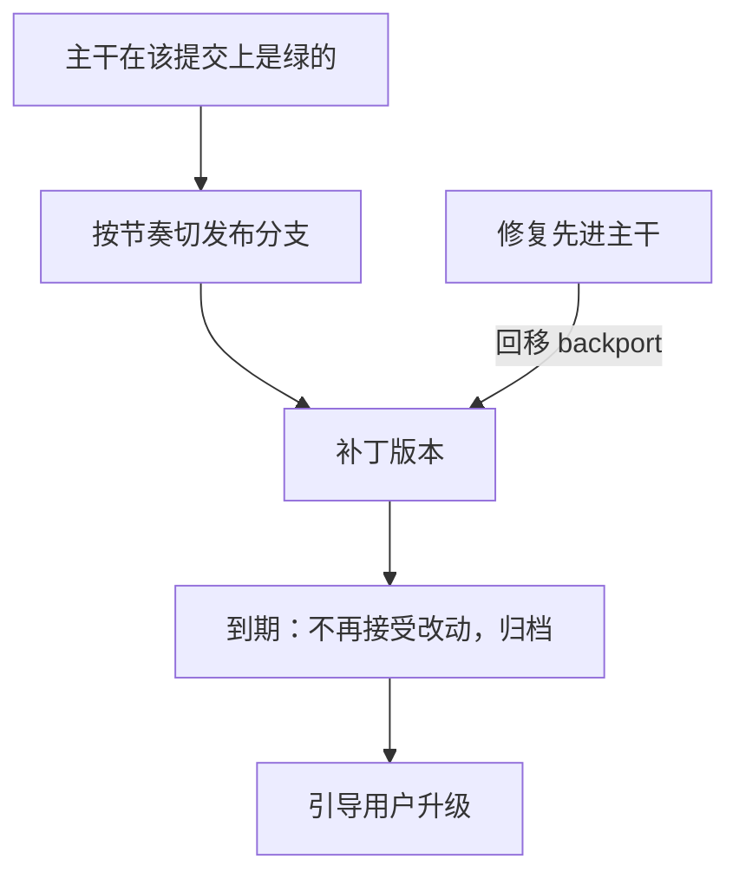

## Q
发布分支什么时候切、活多久？同时维护多个发布分支的成本怎么估算？

## A
**什么时候切**：
- **按时间（发布列车，release train）**：固定节奏切，例如每两周或每四周一次，赶不上的功能坐下一班。可预期，适合多组件协同。
- **按内容**：等某些功能完成再切。容易一拖再拖。
- **切出的前提**：主干在切出的那个提交上是绿的，夜间全集通过，否则一出生就带着已知问题。

**活多久**：取决于承诺给用户的支持期。真实例子：Kubernetes 同时维护最近的 3 个小版本的发布分支，每个小版本（1.19 起）大约有一年的补丁支持。内部服务通常只维护"当前发布"和"上一个发布"两条，用于紧急修复和回滚。

**维护成本的估算**：
- 每个需要回移（backport）的修复，要在每条仍受支持的分支上：挑拣、解决冲突、跑该分支的验证、出补丁版本。
- 例：同时支持 3 条分支，每周 10 个修复中有 4 个需要回移，每次回移平均 2 小时（含冲突和验证），就是每周 4 × 3 × 2 = 24 小时，约 3 人天，还不算验证占用的硬件时间。
- 分支离主干越久，冲突越多，每次回移越贵，成本随分支年龄增长。

**控制成本的办法**：
- 限制支持的分支数量，明确每条分支的结束日期；
- 只回移满足标准的修复（严重缺陷、安全问题），其余等下个版本；
- 修复一律先进主干，再自动开回移请求（脚本或机器人），减少人工；
- 发布分支上的验证用和主干同一套框架，只是档位和配置不同。

**结束**：分支到期后不再接受改动，归档；用户被引导升级到受支持的版本。
