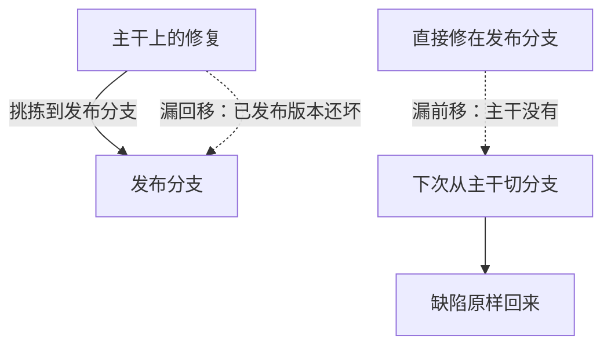

## Q
"漏回移"和"漏前移"分别是什么事故？怎样用 git 命令或工具自动发现发布分支与主干之间的修复差异？

## A
- **漏回移**：修复只进了主干，需要它的发布分支没有挑拣。用户在已发布版本上继续遇到已经"修好"的问题。
- **漏前移**（更常见也更危险）：紧急情况下修复直接合入了发布分支，忘了合入主干。下一次从主干切发布分支，这个缺陷原样回来，形成"修过又坏"的回归。



**发现差异的方法**：

```bash
# 发布分支上有、主干上没有等价改动的提交（+ 开头）
git cherry -v main release/1.8

# 双向对比，按补丁内容去掉两边等价的提交
git log --oneline --cherry-pick --left-only release/1.8...main
```

- `git cherry` 和 `--cherry-pick` 按补丁内容（patch id）判断两个提交是否等价，所以能识别哈希不同但内容相同的挑拣。
- **局限**：挑拣时手工解决过冲突，补丁内容就不再相同，会被误报为"缺失"。所以还要靠第二种方法：

**用提交说明里的来源记录**：挑拣时一律用 `git cherry-pick -x`，提交说明里会带 "(cherry picked from commit <主干提交>)"。脚本读取发布分支上所有这类记录，就能精确知道哪些主干提交已经被挑拣。

**流程上的防护**：
- **发布分支上直接提交的改动必须关联一个主干提交或一张"主干不需要"的说明**，否则 CI 拒绝合入；
- **缺陷单上记录"已修复的分支列表"**，关闭前检查所有受影响的分支都已覆盖；
- **机器人自动开回移请求**：主干修复打上 `backport-1.8` 标签，机器人自动挑拣并开 PR，冲突时通知作者；
- **切新发布分支前跑一次差异报告**：上一条发布分支上所有没有对应主干提交的改动，逐条确认。

把"回归测试和修复一起提交"作为规则，漏前移时这条测试会在主干上失败，相当于多了一道自动检查。
