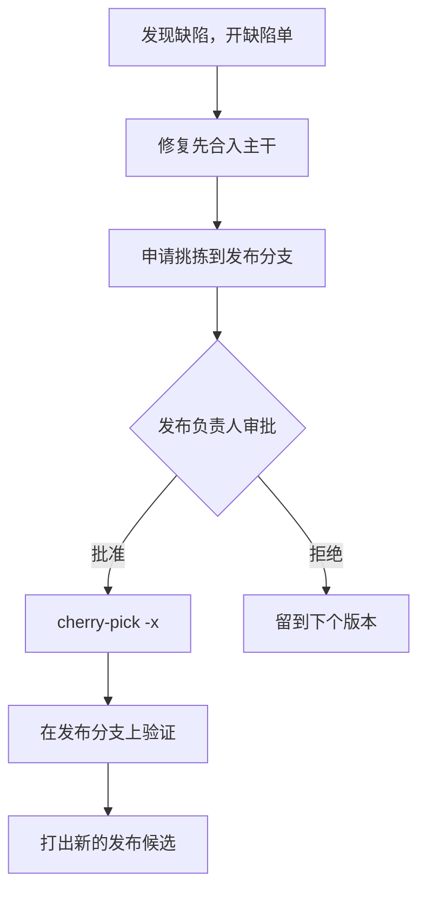

## Q
发布分支切出之后发现一个缺陷，修复怎样进入发布分支？"先进主干"（upstream first）规则是什么，为什么？

## A
**挑拣（cherry-pick）**：把某个提交的改动复制一份应用到另一条分支上，生成内容相同、哈希不同的新提交。**回移（backport）**指把修复从新代码带到旧的发布分支，通常靠挑拣完成。

**标准流程**：

1. **修复先合入主干**，经过正常评审和主干 CI。
2. **提出挑拣申请**：写明缺陷单、严重度、影响范围、修复大小、风险、已有的测试证据。
3. **发布负责人（release owner）审批**：越接近发布，门槛越高。
4. **挑拣**：`git cherry-pick -x <主干提交>`，`-x` 会在提交说明里加一行 "(cherry picked from commit ...)"，记录来源，方便以后追踪。
5. **在发布分支上验证**：构建、复现缺陷的测试、受影响的套件。
6. **出新的发布候选**并更新发布说明。

**为什么先进主干**：
- **防止回归在下个版本重现**：如果只修了发布分支，下一次从主干切分支时，这个缺陷又回来了。这是最常见的回移事故。
- **主干的测试覆盖更全**：修复在主干上先经过所有档位的测试。
- **一处评审**：修复的正确性在主干上被审过一次，发布分支上只需审"挑拣得对不对"。

Linux 稳定版内核的规则是同一个思路：补丁必须已经在主线（mainline）中，且带上游提交号。

**例外**：缺陷只存在于发布分支（主干上的代码已经重写了），这时直接在发布分支上修，并在缺陷单里写明为什么主干不需要。
