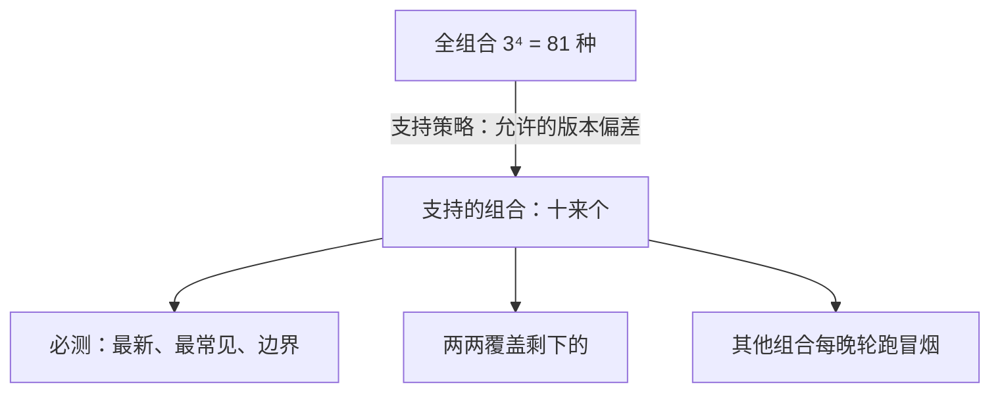

## Q
一个软件栈由框架、编译器、运行时、固件四个组件组成，各自独立出版本。兼容矩阵怎么定？组合太多测不完时，选哪些格子测？

## A
先说四个组件：**框架**是用户写计算的库（例如 PyTorch）；**编译器**把计算翻译成芯片程序；**运行时（runtime）**把程序加载到芯片执行；**固件（firmware）**是芯片上的底层程序。

**组合数爆炸**：每个组件支持最近 3 个版本，就是 3⁴ = 81 种组合；每种组合跑一遍发布验证要一天硬件时间，不可能全测。

**第一步：用支持策略缩小矩阵**。先规定哪些组合是"支持的"，再测这些。真实例子是 Kubernetes 的版本偏差策略（version skew policy）：节点上的 kubelet 不能比 API 服务器新，最多可以旧 3 个小版本；kubectl 只能和 API 服务器相差正负 1 个小版本。照这个思路，可以规定：
- 编译器和运行时必须同一版本，或运行时最多新 1 个版本（新运行时要能加载旧编译器的产物）；
- 固件最多比运行时旧 1 个版本；
- 框架对接口层保证向后兼容 2 个版本。

这样支持的组合从 81 降到个位数到十几个。

**第二步：在支持的组合里按风险选格子**：
- **必测**：本次发布的"同版本组合"（全部最新）；线上最常见的组合（从部署数据统计）；每个"允许偏差"的边界组合（例如新运行时 + 最旧的支持固件）。
- **两两覆盖**（pairwise）：剩下的组合用两两组合测试，保证任意两个组件的任意两个版本至少一起测过一次，用很少的组合覆盖大多数两两交互问题。
- **冒烟级别轮测**：其他支持的组合每晚轮流跑一个小冒烟。

**第三步：让矩阵可见**：一张表，行是组合，列是测试档位，格子是最近一次结果和日期。没有测过的支持组合要显眼地标出来，它是发布评审时要回答的风险。

不在支持范围内的组合，运行时启动时要检测并给出清楚的报错，而不是"试试看"。
