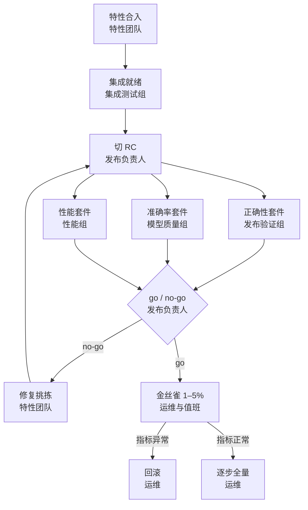

## Q
以一个大语言模型推理服务为例，一次发布从特性合入到全量上线经过哪些关卡？每一关由谁负责、看什么证据？

## A
先说被测系统。**大语言模型（LLM）** 是一大组训练好的数字（参数，parameter）加一串固定的计算步骤；"7B 模型"约有 70 亿个参数。**推理服务**收到一句聊天请求，把文字切成 **token**（模型处理文字的最小单位，约等于一个词或词的一部分），然后一次算出一个 token，直到回答完毕。下面以"7B 模型回答一条聊天请求"为例。

- **特性合入**（特性团队）：特性在主干上通过自己的特性测试，默认关在开关后面。
- **集成就绪**（集成测试组）：特性与编译器、运行时、其他特性一起跑跨组件测试，无未分诊失败，才算准备好上车。
- **切发布候选 RC**（发布负责人）：从绿色主干切出，固定一份制品。
- **正确性**（发布验证组）：服务行为对不对：接口返回格式、停止条件、长输入、并发请求、错误处理；同样输入的输出与参考实现在容差内一致。
- **准确率**（模型质量组）：让模型回答一套有标准答案的题目，算答对比例，和上一版本比，确认没有"变笨"。
- **性能**（性能组）：首个 token 的延迟、每秒生成的 token 数、在延迟目标内能承受的并发，与基线比较。
- **go / no-go**（发布负责人）：汇总三类证据和已知问题，决定发布与否。
- **金丝雀**（运维与值班）：先让 1–5% 的线上流量用新版本，对比错误率、延迟和用户反馈；异常就回滚。
- **逐步全量**（运维）：分几步扩大到 100%，每一步都观察一段时间。

每一关都回答同一个问题：**有什么证据说明它可以进入下一关**。
