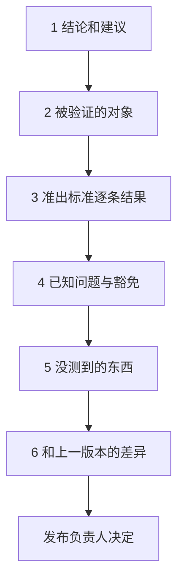

## Q
go / no-go 会议上，测试负责人应该带一份什么样的材料？怎样做到"用证据说话"，而不是"我觉得可以"？

## A
**原则：别人不需要相信你，只需要看你的材料就能得出同样的结论**。

**一页式发布就绪报告**：

1. **结论和建议**：一句话，例如"建议发布；有 2 个已豁免的已知问题，见第 4 部分"。
2. **被验证的对象**：发布候选编号、制品摘要、各组件版本清单。证明这些证据属于这个版本。
3. **准出标准逐条结果**：

| 标准 | 门限 | 实际 | 状态 |
|---|---|---|---|
| 阻断级套件 | 100% 通过 | 1,842 / 1,842 | 通过 |
| 准确率（数学题集） | 差异不显著且下降 ≤ 1 点 | −0.4 点，不显著 | 通过 |
| 首个 token 延迟 p99 | 退化 ≤ 5% | +3.1% | 通过 |
| 长稳 12 小时 | 无内存增长 | 平稳 | 通过 |

（首个 token 延迟：从请求发出到收到回答第一个字的时间；准确率：在有标准答案的题集上答对的比例。）

4. **已知问题与豁免**：每条写明影响、触发条件、规避办法、批准人、修复计划和到期版本。
5. **没测到的东西**：明确说出这次因为硬件或时间没覆盖的配置，以及对应的风险判断。这是最容易被省略、也最重要的一项。
6. **和上一版本的差异**：哪些指标变好、哪些变差，变差的原因是否已知。

**会议上的做法**：
- 先给结论，再给证据；
- 有人质疑某项指标时，能立刻点到原始数据（结果库链接、运行编号）；
- 不确定的地方直接说不确定，并给出可以降低风险的办法，例如延长金丝雀阶段（先给一小部分流量用新版本的阶段）；
- 决定权在发布负责人；测试负责人的职责是让风险清楚可见，而不是替别人承担决定。

报告和会议结论存档，事后复盘时能核对"当时知道什么、怎么决定的"。
