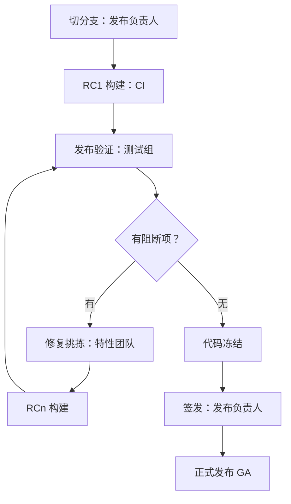

## Q
一个发布候选（release candidate，RC）从切出到正式发布经过哪些阶段？每个阶段由谁负责、产出什么？

## A
**发布候选**：一个打算发布的确切版本（一组固定的提交和制品），要经过验证才可能成为正式版本。不过关就修复后出下一个候选：RC1、RC2……

1. **切分支**（发布负责人）：从一个绿色的主干提交切出发布分支，记录各组件版本。产出：发布分支、版本清单。
2. **RC1 构建**（CI 系统）：构建一次，所有后续验证引用同一份制品。
3. **发布验证**（测试或发布验证团队）：跑发布验证档的全部套件：完整回归、长稳、性能、正确性门限。产出：一份结果报告和阻断项清单。
4. **稳定期**：阻断项分诊（严重度、是否阻断、负责人）；修复先进主干再挑拣到分支；每批修复出一个新 RC，对受影响部分重新验证。
5. **代码冻结**（code freeze）：临近发布日，分支上只接受阻断级修复，每个改动都要发布负责人批准。
6. **签发**（sign-off）：各方（测试、各组件负责人、有时还有产品和运维）按准出标准确认；发布负责人做出发布 / 不发布（go / no-go）决定。
7. **正式发布**（GA，general availability）：最后一个 RC 的制品原样晋升为正式版本，不重新构建；打标签，发布说明列出已知问题。

**两个关键约束**：
- **正式版本必须是被验证过的那一份制品**，按摘要引用；
- **每个阶段都有明确的负责人**，否则阻断项会在团队之间来回踢。
