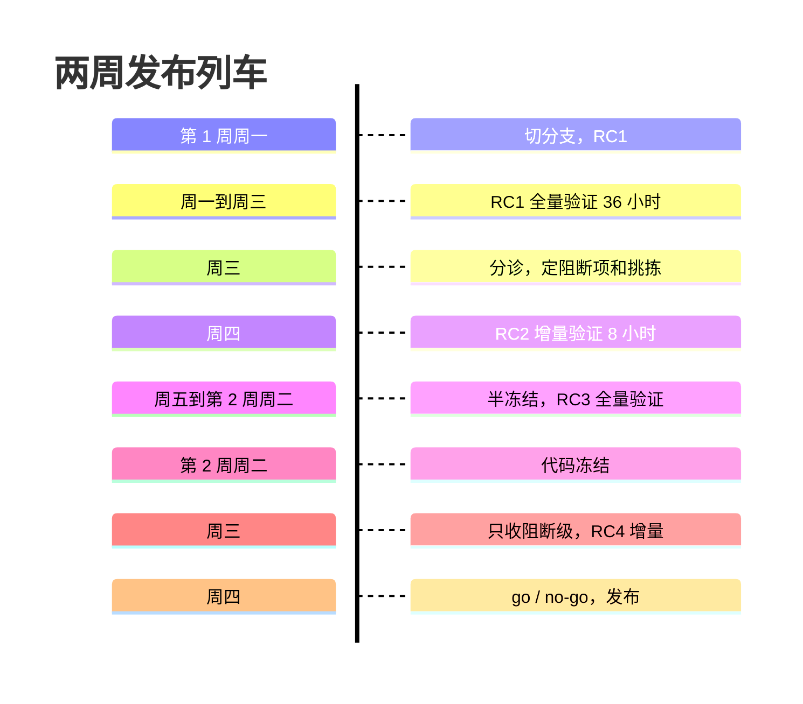

## Q
一个两周一次的发布列车，发布验证全量要 36 小时的硬件时间。排一个从切分支到发布的时间表，并算一下最多能容纳几个发布候选。

## A
**假设**：周一切分支；发布验证全量 36 小时；对少量修复做增量验证（只跑受影响的组件和冒烟）要 8 小时；下周四做发布 / 不发布（go / no-go）决定，周五不发布（出问题时周末没人处理）。

| 时间 | 事件 |
|---|---|
| 第 1 周周一 上午 | 从绿色主干切分支，构建 RC1 |
| 周一中午 – 周三凌晨 | RC1 全量验证（36 小时） |
| 周三 | 分诊结果，确定阻断项和挑拣 |
| 周四 | RC2 构建，增量验证 8 小时 |
| 周五 – 第 2 周周二 | 半冻结；再出 RC3 并完成一次全量验证（36 小时，赶在冻结前） |
| 第 2 周周二 | 代码冻结 |
| 周三 | 只允许阻断级修复；如有，RC4 增量验证 |
| 周四 | go / no-go，正式发布 |

**能容纳几个 RC**：
- 全量验证占 36 小时，两周里最多安排 2 次（RC1 和冻结前的那个），否则硬件时间不够，也会和主干的夜间测试抢设备。
- 增量验证 8 小时，中间可以穿插 2–3 次。
- 所以一个健康的周期大约是 3–4 个 RC。超过这个数，要么验证覆盖不足，要么发布推迟。

**由此得到的规则**：
- **最后一次全量验证必须针对最终发布的那个 RC，或者与它只差已增量验证过的挑拣**；
- **攒批挑拣**：不要每来一个修复就出一个 RC，按天汇总；
- **验证时间是硬约束**：冻结日前没法完成验证的修复，就不能进这个版本。

具体数字因团队而异，面试时说出这样的推算过程比背一个固定时间表更有说服力。
