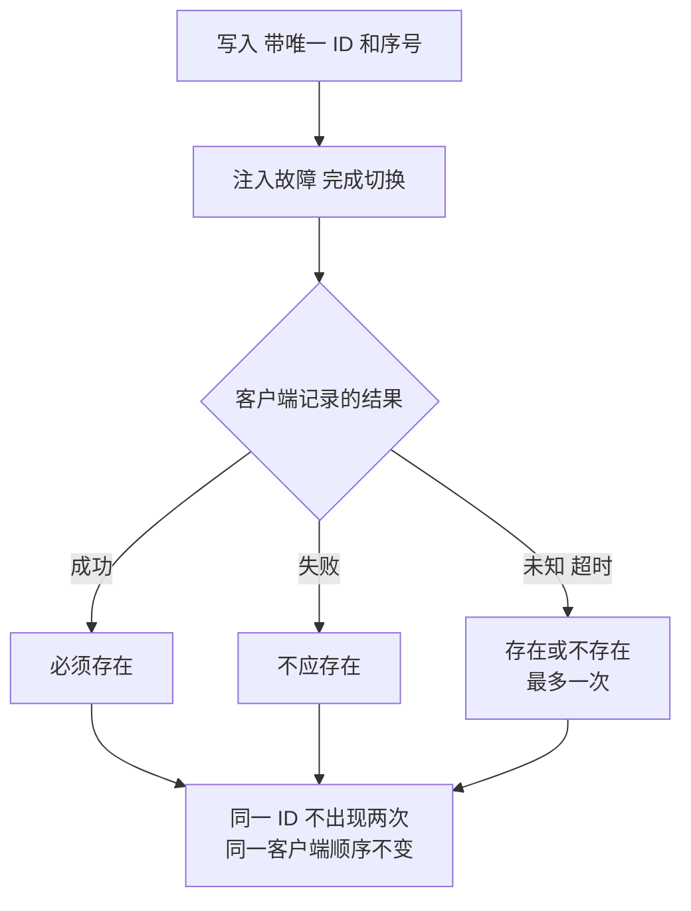

## Q
故障切换测试只看"服务恢复了"是不够的。怎么验证切换前后数据和请求的正确性？

## A
**核心方法：记录完整的操作历史，事后检查一致性**。

1. **测试期间持续写入带唯一编号的数据**：每个写请求带一个唯一 ID 和单调递增的序号，客户端记录每个请求的结果：成功、失败、或结果未知（超时，不知道服务端是否执行了）。
2. **注入故障并完成切换**。
3. **事后核对**：
   - **确认成功的写入必须全部存在**：缺失一条就是数据丢失；
   - **确认失败的写入不应存在**：存在说明服务端执行了却告诉客户端失败，客户端重试就会重复；
   - **结果未知的写入**：可以存在也可以不存在，但最多存在一次；
   - **没有重复**：同一个 ID 不能出现两次（检查重试是否幂等）；
   - **顺序**：同一个客户端的写入顺序在新主节点上保持一致。

4. **读一致性**：切换后立刻读刚写入的数据，看能否读到；如果系统承诺线性一致（linearizable），可以用 Jepsen 这类工具的历史检查器（例如 Elle、Knossos）自动验证整段历史是否满足承诺的一致性模型。

**对无状态服务**（例如推理服务：把训练好的模型部署成接口，每个请求独立计算、不保存数据）：重点从"数据丢失"转向"请求结果"。
- 切换期间被中断的请求，客户端必须收到错误，不能收到被截断却显示正常结束的结果；
- 客户端重试后得到完整、正确的结果；
- 负载均衡把新请求导向健康实例，被摘掉的实例恢复后重新加入时，先通过就绪检查再接流量。

**常见缺陷**：故障前最后几百毫秒内"确认成功"的写入在切换后消失，因为主节点在复制到副本前就回复了客户端。这正是异步复制的代价，测试要量出这个窗口有多大。
