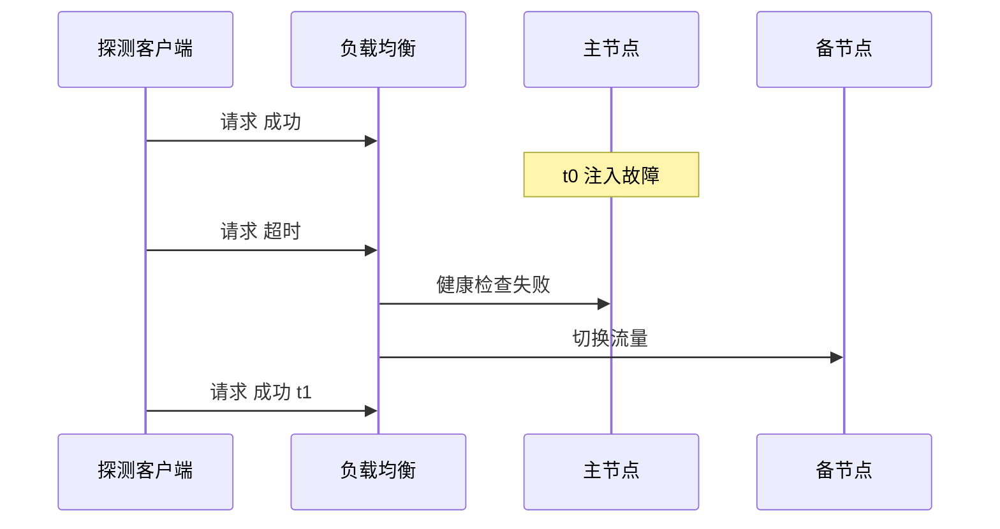

## Q
怎么准确测量一次故障切换花了多久？健康检查的配置怎样决定检测时间？

## A
**用客户端视角的连续探测来测**：在故障注入前启动一个探测客户端，以固定间隔（例如每 100 毫秒）发请求，记录每个请求的发送时间和结果。

- **不可用时长** = 第一个失败请求的时间到恢复后第一个成功请求的时间（t1 − t0 附近）；
- **受影响请求数**：期间失败的请求个数和类型（超时、连接拒绝、错误码）；
- 多次重复（例如 20 次）取分布，看最大值，而不是只跑一次。

**检测时间由健康检查参数决定**：检测时间 ≈ 检查间隔 × 连续失败阈值 + 单次检查超时。以 Kubernetes 就绪探针（readiness probe）的默认值为例：`periodSeconds: 10`、`failureThreshold: 3`、`timeoutSeconds: 1`，最坏情况大约 30 秒才把一个卡死的实例摘掉。如果恢复时间目标是 10 秒，默认配置就不可能达标。

**权衡**：间隔越短、阈值越小，检测越快，但一次短暂抖动（垃圾回收停顿 2 秒）就可能触发误切换，切换本身也有代价。测试时要同时验证两边：真故障在目标时间内被检测，短暂抖动不触发切换。
