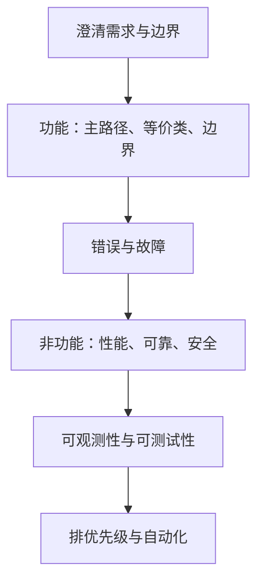

## Q
面试里被问"你怎么测 X"（X 可以是一个 API、一个缓存、一台电梯），通用的答题框架是什么？

## A
按这个顺序说，先结构后细节：

- **澄清需求与边界**：X 给谁用、核心功能是什么、规模多大、有哪些约束（延迟、正确性要求）。不问就开始列用例是最常见的扣分点。
- **功能正确性**：主路径的正常输入与期望输出；然后是**等价类和边界值**：空、单个、最大值、刚超过最大值、非法类型。
- **错误与故障**：非法输入如何报错；依赖超时、崩溃、返回错误时 X 怎么表现；并发访问、重复请求。
- **非功能**：性能（延迟分位数、吞吐、容量上限）、可靠性（长时间运行、故障恢复）、安全（鉴权、注入）、兼容性（旧客户端、旧数据格式）。
- **可观测性与可测试性**：怎么知道 X 在线上正常？需要哪些指标和日志？X 是否提供了让测试能控制时间、随机数的入口？
- **排优先级与自动化**：哪些先测（风险最高的），哪些进提交前套件，哪些放夜间，哪些只在发布前跑。

**像"怎么测一支笔"这种类比题**也用同一个框架：澄清（给谁写、写在什么上）、功能（能写出线条）、边界（极冷、倒着写、写到墨水用尽）、故障（摔落、漏墨）、非功能（书写距离、寿命）、优先级。面试官看的是结构和取舍，不是用例个数。
