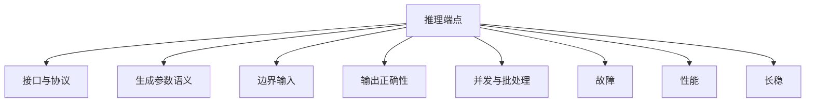

## Q
怎么测一个兼容 OpenAI 接口的大语言模型推理端点（`/v1/chat/completions`）？请按类别列出最重要的测试。

## A
**先用大白话说清对象**：大语言模型（LLM）是一个程序，输入一段文字，一次生成一小段后续文字，循环下去直到写完。它处理文字的单位叫 token，大约是一个词或半个词。用户发来的文字叫 prompt；模型一次最多能看的 token 数叫上下文长度（context length）。每一步模型给所有候选 token 打分，每次都选最高分的那个叫贪心解码（greedy），所以结果应当是确定的。

- **接口与协议**：字段符合规范；`stream=true` 时是合法的服务器推送事件（SSE）流，以 `data: [DONE]` 结束；参数错返回 400，超限返回 429。
- **生成参数语义**：`max_tokens` 精确限制输出长度；`stop` 字符串出现即停止且不出现在输出里；`temperature=0`（相当于贪心）时，同一请求单独发送多次输出相同。
- **边界输入**：空消息、只有空白、prompt 刚好等于和超过上下文长度、多语言和 emoji。
- **输出正确性**：与参考实现（同一份模型数据在 PyTorch 里的运行结果）逐 token 对比贪心输出；在一组固定问题上打分，与上一版本比较。
- **并发与批处理**：服务会把多个请求打包成一批（batch）一起算。断言每条结果与单独发送时相同；若实现做不到完全相同，分歧只应出现在两个候选得分几乎相等的位置，并统计分歧率。中途取消一个流式请求，不影响同批其他请求。
- **故障**：后端进程崩溃时客户端收到错误而不是永远挂起；过载时返回 429 或排队。
- **性能**：首个 token 的等待时间（TTFT）、之后每个 token 的间隔（TPOT）、吞吐，在不同请求速率下的 p50 和 p99，用 `vllm bench serve` 一类工具测。
- **长稳**：额定负载下连续运行数小时，内存和延迟不漂移。

优先级：正确性和批处理一致性最高（错了也不报错），其次是故障行为和性能。
