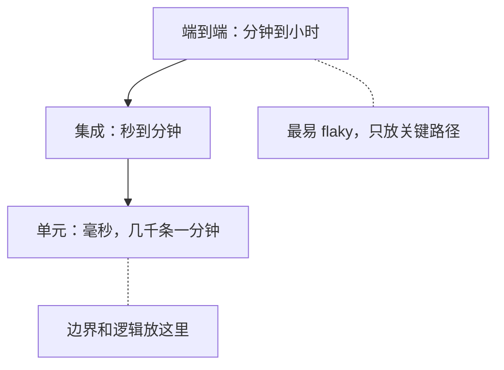

## Q
同一个检查放在单元、集成、端到端三层，运行时间和稳定性大约差多少？为什么不该把所有逃逸缺陷都补成端到端测试？

## A
**量级对比**（典型值，不同项目会差几倍）：
- **单元测试**：毫秒级，几千条在一分钟内跑完；几乎不 flaky；失败直接指向一个函数。
- **集成测试**：秒到分钟级，需要启动进程、容器或模拟器；偶尔受端口、时序影响。
- **端到端测试**：分钟到小时级，需要完整部署和真实硬件；依赖多，最容易 flaky；失败后要花时间定位是哪一层出的错。

Bazel 的测试尺寸（test size）把这种差别写成了默认超时：small 60 秒、medium 300 秒、large 900 秒、enormous 3600 秒。

**全补成端到端的代价**：
- **反馈变慢**：端到端套件只能在提交后或夜间跑，缺陷要几小时后才被发现，期间又合入了几十个提交，定位更难。
- **稀缺资源被占满**：真实硬件时间有限，低价值的端到端用例挤掉了真正需要硬件的测试。
- **信号变差**：端到端越多，flaky 越多，大家开始忽略红灯。
- **定位差**：端到端失败只能说明"有地方坏了"。

**合理分工**：端到端测试只验证"各部分接起来能工作"的少数关键路径，例如一条请求从 API 到设备再返回；具体的边界和逻辑放在下层覆盖。
