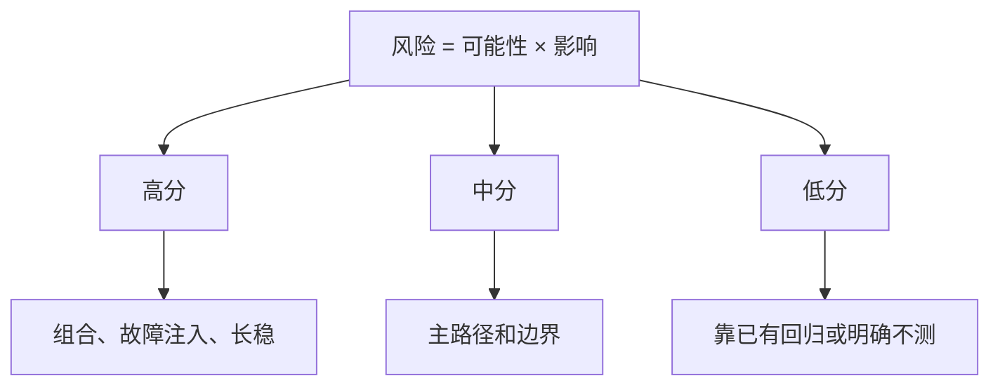

## Q
面试里被问"你怎么决定先测什么、测到什么程度"，怎么答？

## A
按这个顺序说：

- **用风险排序**：风险 = 出错可能性 × 影响。我先和开发、产品一起列出风险项，各打 1–5 分。
- **可能性看数据**：改动规模和集中度、近期代码搅动、组件历史缺陷密度、依赖升级、改动行的覆盖缺口。
- **影响看后果**：用户是否可见、是否静默错误（结果错了却不报错最严重）、影响面多大、能否回滚。
- **按分数定深度**：高分项做组合测试、故障注入、长稳；中分项测主路径和边界；低分项只靠已有回归，或者明确不测。

- **说出不测什么**：不测的项写下理由和残余风险，由发布负责人签字接受；用两两组合和夜间抽样兜底没想到的组合。
- **闭环校准**：每个逃逸缺陷回头看当时的打分，调整下一次的权重。

可以补一个例子：某次版本同时有新的计算 kernel（在加速芯片上跑的底层计算代码）和日志改动，kernel 得 20 分，分配大部分硬件时间做与参考实现的对比和大尺寸输入测试；日志只看冒烟。
