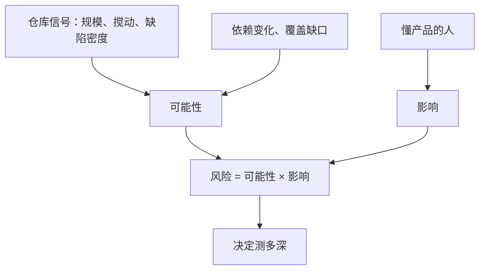

## Q
评估一次改动的出错可能性时，有哪些可以从代码仓库里直接量出来的信号？

## A
- **改动规模**：`git diff --stat <base>..<rc>` 看改动行数和文件数；大改动出错概率高，但更重要的是**集中在哪些模块**。
- **代码搅动（churn）**：`git log --since=30.days --numstat -- <path>` 统计近期反复修改的文件；经常被改的文件缺陷密度通常更高。
- **历史缺陷密度**：把缺陷追踪系统里的修复提交映射回文件或组件，算每个组件近几个版本的缺陷数。
- **新代码比例**：全新模块没有经过生产检验，风险高于对成熟模块的小修改。
- **依赖变化**：编译器、运行时、驱动、第三方库升级（锁文件 `uv.lock`、`requirements.txt` 的差异）经常带来没人预料的行为变化。
- **覆盖缺口**：用 `coverage run -m pytest` 后 `coverage report` 或 diff 覆盖率工具，查看本次改动行中有多少没有被任何测试执行。
- **作者与评审**：首次改动某模块的作者、评审很快通过的大改动，风险更高（这条只能作参考，不能用来责备个人）。

**用法**：这些信号决定"可能性"一项的分数，而"影响"必须由懂产品的人判断，代码里量不出来。把信号做成发布前自动生成的报告，测试负责人据此调整计划，比凭印象排序可靠得多。
