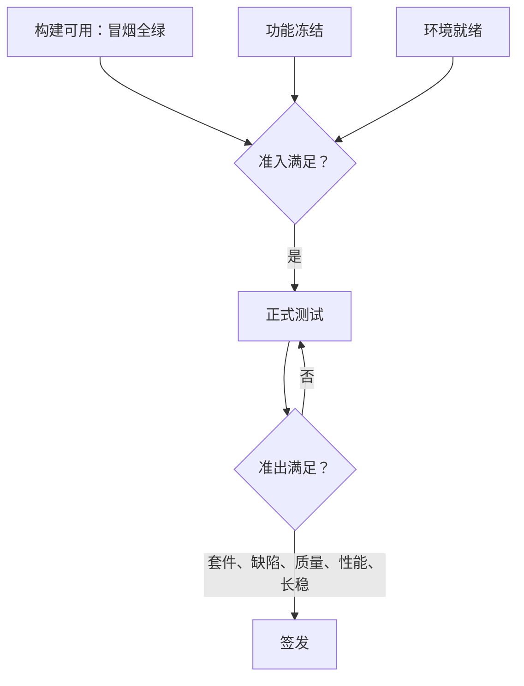

## Q
测试计划里的准入标准（entry criteria）和准出标准（exit criteria）怎么写才算合格？举一个在线服务发布的例子。

## A
原则：**每条都能用一个命令或一张看板判定真假**，不能是"质量良好""基本稳定"这种形容词。

**准入标准**（不满足就不开始正式测试，避免在一个半成品上浪费稀缺硬件）：
- **构建可用**：发布候选（release candidate）构建成功，冒烟套件（smoke suite）全绿；
- **功能冻结**：计划内的功能已合入，不再有新特性进入这个分支；
- **环境就绪**：测试集群、测试数据、依赖服务到位，健康检查通过。

**准出标准**（满足才可以签发）：
- **套件**：发布回归套件中非隔离用例 100% 通过；隔离（quarantine）中的用例每条都有负责人和工单；
- **缺陷**：P0、P1 未关闭数为 0；P2 以下逐条有豁免记录；
- **结果质量**：在一组固定的标准输入（评测集）上，输出的正确率与上一版本相差不超过约定门限（例如绝对 0.5 个百分点）；
- **性能**：吞吐与 p99 延迟相对基线的回退在统计阈值以内（例如不差于 3%，且多次重复后显著）；
- **长稳**：额定负载下长稳测试跑满约定时长，内存曲线平稳。

**常见错误**：只写准出不写准入，结果测试团队在构建不稳的分支上反复跑大套件；或者准出写成"所有用例通过"，没有区分隔离用例和已豁免问题，到发布当天才争论哪些失败"不算"。门限数字要在计划评审时就定下来，而不是看到结果后再定。
