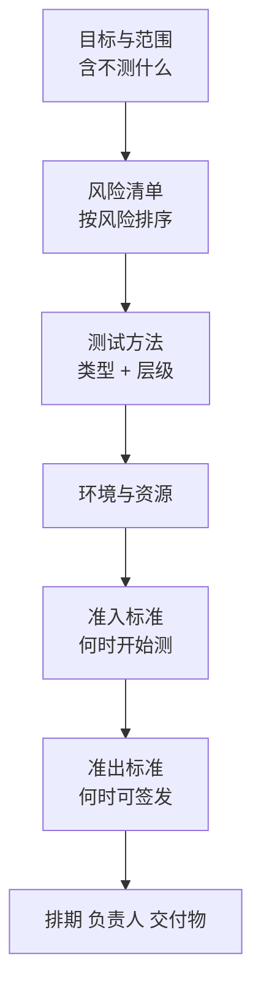

## Q
一份测试计划（test plan）由哪几部分组成？每一部分回答什么问题？

## A
测试计划回答一句话：**这次改动测什么、怎么测、测到什么程度算完、谁来做、什么时候做**。IEEE 829 和后来的 ISO/IEC/IEEE 29119-3 给的模板很长，实际工作里压缩成七块就够用：

- **目标与范围**：被测对象和版本（例如订单服务 v2.3 新增的结果缓存：相同查询直接返回上次算好的结果）；**明确写出"不测什么"**，例如"不测后台管理页面、不测已下线的 API v0"，并说明理由。
- **风险清单**：哪些地方最可能出错、出错后果多大，按风险排序，决定测试投入的分配。
- **测试方法**：每个风险对应的测试类型（功能、集成、精度、性能、故障注入、兼容性）和所在层级（单元、集成、端到端）。
- **环境与资源**：需要的机器、模拟器、测试数据；稀缺设备（例如专用加速芯片的测试机）要提前预约。
- **准入标准（entry criteria）**：满足什么条件才开始正式测试，例如构建通过冒烟、功能代码冻结。
- **准出标准（exit criteria）**：满足什么条件才算测完、可以签发，必须可度量。
- **排期、负责人与交付物**：每块谁负责、何时完成、输出什么（测试报告、已知问题清单）。

一份好计划的标志：读完的人能说出**最大的三个风险**、**哪些东西故意没测**、**什么数字达标就放行**。
