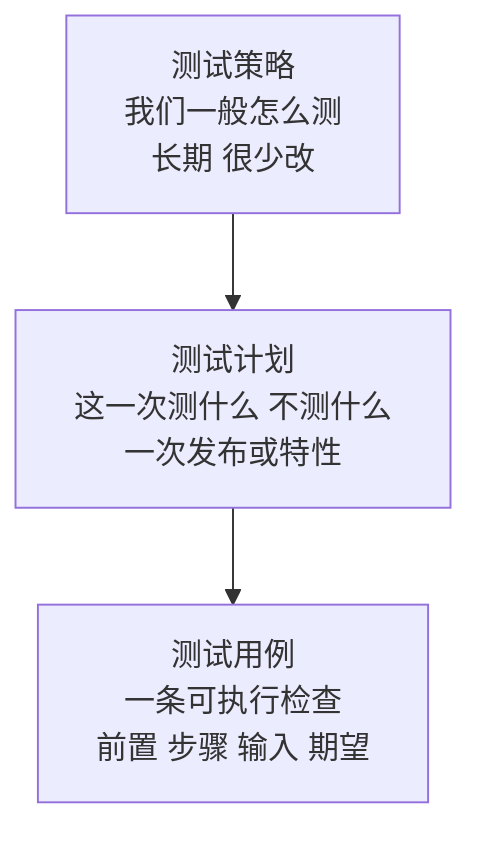

## Q
测试策略（test strategy）、测试计划（test plan）和测试用例（test case）有什么区别？

## A
三者是从长期到具体的三层：

- **测试策略**：组织或产品线层面的长期约定，很少改。例如"所有功能必须有单元测试；跨组件改动必须有集成测试；每个发布候选必须跑完发布验证套件和 24 小时长稳；数值结果用参考实现对比判定"。它回答"我们一般怎么测"。
- **测试计划**：针对一次发布或一个特性的具体安排，随项目生命周期存在。它在策略的框架下回答"这一次测什么、不测什么、风险在哪、门限是多少、谁在什么时间做"。
- **测试用例**：一条可执行的检查，有前置条件、步骤、输入和期望结果，例如"同一个查询单独发送，和与另外 31 个查询打包一起发送，返回的结果相同"。

**容易混淆的地方**：
- **计划不是用例清单**：把几百条用例罗列出来不等于有计划；计划的价值在于风险排序、取舍和准出标准，用例只是落实手段。
- **策略不能替代计划**：策略说"性能要测"，计划才说"这次结果缓存要测命中率在 0%、50%、90% 时的 p99 延迟，门限是任何命中率下都不差于关闭缓存"。

面试里这个区分常用来判断候选人是只会写用例，还是能对一次发布的测试负责。
