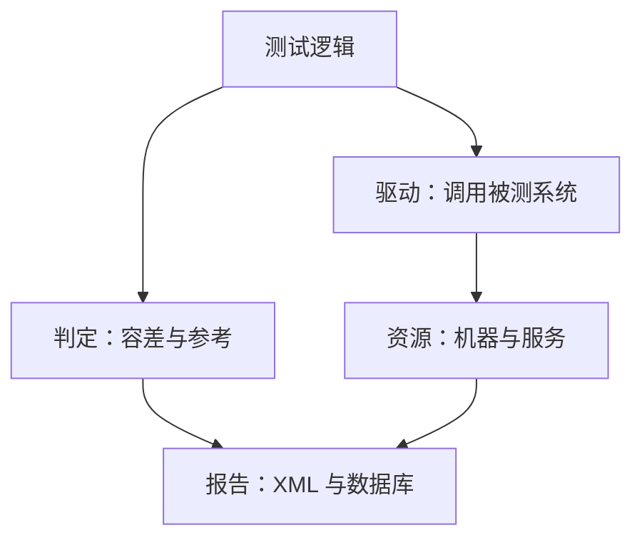

## Q
一个要测多组件系统（例如跑在加速芯片上的推理服务）的自动化测试框架，通常分成哪几层？每层负责什么？

## A
先说被测系统：**推理服务（inference service）** 是把训练好的模型（model，一大组数字参数加一串固定计算步骤）部署成在线服务，收到请求就算出回答；**加速芯片（accelerator）** 是专门做大规模数值计算的芯片，例如 GPU。

分层的目的：**谁变了，只改谁那一层**。常见五层，从下到上：

- **资源与环境层**：申请机器和设备、安装指定版本的软件、启动服务、测试后清理。测试代码不知道自己跑在哪台机器上。
- **驱动层（driver / client）**：把被测系统包装成简单的调用，例如 `server.generate(prompt, max_tokens=16)`，内部负责 HTTP、重试、超时和日志。换接口或换硬件只改这一层。
- **测试逻辑层**：真正的用例，只描述"输入什么、期望什么"，不写端口号、机器名和 `sleep`。
- **判定层（oracle / assertion）**：怎么判断对错，例如精确比较、浮点容差比较、和参考实现对比。集中实现，避免每条测试各写一套容差。
- **报告层**：把结果写成标准格式（JUnit XML），附上版本号、机器、日志链接，上报结果数据库。

**检验分层是否合格的问题**：要支持一种新硬件，需要改几个文件？好的答案是"资源层加一个配置，驱动层可能加一个适配器，测试逻辑一行不动"。
