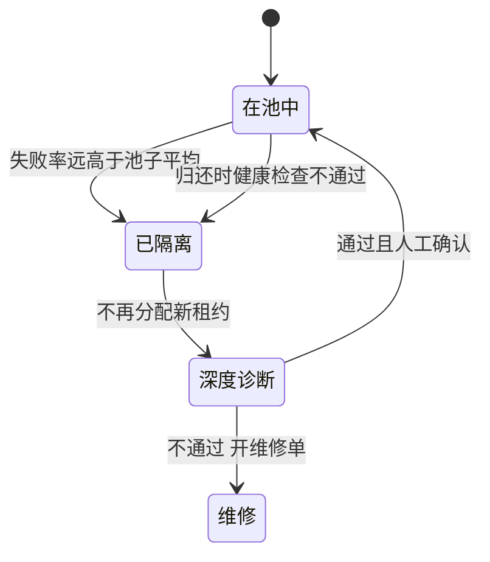

## Q
测试实验室里总有几台"坏机器"，让上面跑的测试随机失败。怎样自动发现坏机器并让它下线，又不把产品缺陷误判成机器问题？

## A
**判断依据：失败跟着机器走，还是跟着代码走。**

- **跟着机器走**：同一台机器上，多个互不相关的测试、在多个不同的提交上都失败；同样的测试换到别的机器就通过。→ 机器问题。
- **跟着代码走**：某个提交之后，这条测试在所有机器上都失败。→ 产品回归。

**自动化做法**：
1. **每次失败都记录机器编号**，结果库里能按机器聚合。
2. **按机器算失败率并和池子平均比**：例如过去 24 小时某机器失败率 30%，同类机器平均 3%，且失败分布在 5 条以上不同的测试上。
3. **触发后自动隔离机器**：不再分配新租约，跑一遍深度诊断（设备自检、内存测试、链路检查、温度和错误计数器）。
4. **诊断通过且人工确认后回池**；不通过开维修单，附上失败记录。
5. **被它弄红的测试重新调度**到健康机器上复跑，复跑结果才计入产品信号。

**每次租用前后的健康检查**比事后统计更快：归还时跑 30–60 秒的检查（设备能被枚举、一个小计算结果正确、温度正常），不通过立刻下线。

**防止误判的两条规则**：
- **只看单机失败率不够**：如果一个新提交让所有机器失败率都升高，那是产品回归，不能把机器一台台全下线。所以阈值要和"同一时间段的池子平均"比较。
- **设下线上限**：例如一小时内自动下线超过池子 10%，就停止自动下线并呼叫人，因为更可能是驱动或固件更新这类全局变化。

要报的指标：每周自动下线次数、误下线比例（诊断后发现机器没问题）、维修周转时间。
