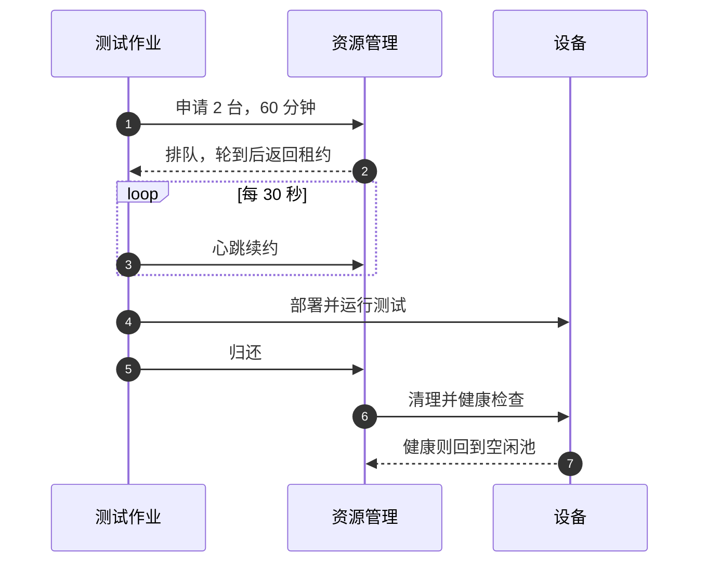

## Q
几十个测试作业要共享少量稀缺的测试设备（例如加速芯片机器）。"租约"（lease）机制是怎么工作的？一次租用从申请到归还经过哪些步骤？

## A
加速芯片（accelerator）是专门做大规模数值计算的芯片，例如 GPU，一台机器很贵、数量少，所以不能让每个作业随便连一台用。

**租约 = 有期限的独占使用权**。资源管理服务记住"哪台设备、借给谁、到什么时候"。

1. **申请**：说明资源类型、数量、预计时长和优先级，不指定具体机器。
2. **排队与分配**：按类型分队列；资源够时一次性分配全部所需设备，返回租约编号和到期时间。
3. **续约**：作业定期发心跳。心跳停了（作业崩溃、机器断网），租约到期后自动收回。
4. **使用**：作业只能操作租到的设备，其他作业看不到它。
5. **归还与清理**：归还后不直接给下一个人，先恢复到干净状态（重置设备、删临时文件、杀残留进程），再跑一个几十秒的健康检查。
6. **入池或下线**：检查通过回到空闲池；不通过则标记待修，不再分配。

关键点：**清理和健康检查是租约的一部分**，否则上一个测试的残留会让下一个无关测试失败，被误判成产品问题。
