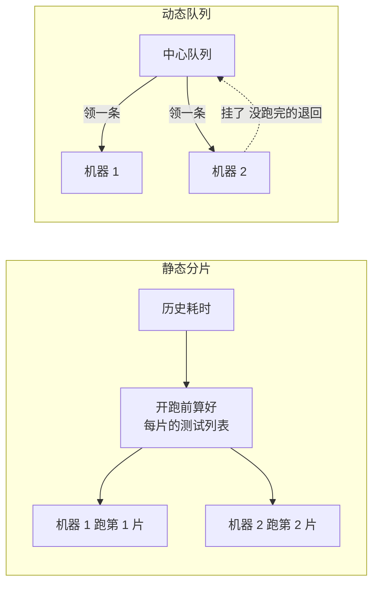

## Q
跨多台机器分片时，"静态分片"（事先算好每片跑哪些）和"动态队列"（机器空了就领下一条）各有什么优缺点？常见工具怎么实现静态分片？

## A
**静态分片**：开跑前按历史耗时算好每个分片的测试列表，每台机器只跑自己那份。
- 优点：简单，不需要中心服务；每个分片的测试集合固定，失败容易复现（"第 3 片挂了，本地跑第 3 片"）。
- 缺点：耗时估计不准时负载不均；某台机器慢或中途挂了，它那份没人接手。

**动态队列**：所有测试放进一个中心队列，每台机器跑完一条就领下一条。
- 优点：自动平衡，慢机器少领、快机器多领；机器挂了，它没跑完的测试回到队列。
- 缺点：需要一个队列服务；每条测试在哪台机器跑不固定，顺序依赖类的问题更难复现；每领一次有调度开销，测试很短时不划算（可以一次领一批）。

**静态分片的常见实现**：
- **pytest-split**：先 `pytest --store-durations` 跑一遍全集，生成 `.test_durations` 文件；之后每台机器跑 `pytest --splits 4 --group 2`（组号从 1 开始）。`--splitting-algorithm least_duration` 每次把测试放进当前最轻的组，比默认的 `duration_based_chunks` 更均衡。
- **Bazel**：测试目标写 `shard_count = 4`，Bazel 把测试启动 4 次，用环境变量 `TEST_TOTAL_SHARDS` 和 `TEST_SHARD_INDEX`（从 0 开始）告诉测试程序自己是第几片，测试程序据此只跑自己那份。
- **CI 矩阵**：GitHub Actions 里 `strategy.matrix.group: [1, 2, 3, 4]`，每个作业把组号传给 `--group`。

**硬件测试通常选动态队列**：设备是稀缺资源，空闲一分钟就是浪费；而且设备会坏，需要把任务转给别的设备。纯软件的提交前测试用静态分片就够了。
