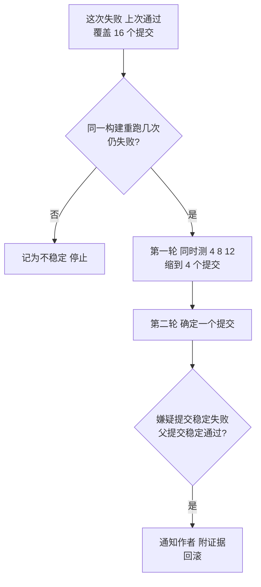

## Q
提交后测试不是每个提交都跑，而是每隔一批提交跑一次。测试变红后，CI 系统怎样自动找出是哪个提交（culprit finding）？要注意什么？

## A
**为什么要批量跑**：主干每小时合入几十个提交，慢测试（例如硬件测试一小时）不可能每个提交都跑，所以每次运行覆盖自上次以来的一批提交。代价是变红时，嫌疑不是一个提交，而是一批。

**自动找元凶的流程**：
1. **触发**：某次运行中一条测试失败，而上一次运行它通过；这次运行覆盖了 16 个提交。
2. **先确认不是 flaky**：在同一构建上重跑这条测试几次。都通过就记为不稳定，停止；仍失败才继续。
3. **在批内二分**：只针对这一条失败的测试，在 16 个提交里二分，约 4 次运行。每次运行可以并行：直接同时测第 4、8、12 个提交，一轮就把范围缩小到 4 个，第二轮确定一个。并行的轮数更少，代价是多用机器。
4. **确认**：在嫌疑提交和它的父提交上各跑多次，前者稳定失败、后者稳定通过才算确认。
5. **行动**：通知作者，在缺陷单和代码评审页面附上证据；按团队规则自动开回滚改动，或等值班确认后回滚。

**要注意的问题**：
- **不稳定测试会把二分带偏**：二分路径上任何一次误判都会指向错误的提交，并且看起来很确定。对策是每个点多跑几次，并按测试的历史不稳定率决定次数。
- **多个回归叠加**：一批里有两个提交分别引入了不同的问题，二分只会找到其中一个。修掉后再看测试是否全绿。
- **问题来自环境而不是提交**：驱动在测试机上被升级了，所有提交都"变坏"，二分会把第一个被测试的点判为元凶。对策：先在上一次通过的提交上重跑，确认它仍通过。
- **只二分一条代表性测试**：同一个原因导致 20 条测试失败，按失败签名分组后只为每组选一条测试二分，避免浪费机器。
- **误回滚的代价**：自动回滚要求证据确定（多次重复），并且通知作者，让他能快速申诉。
