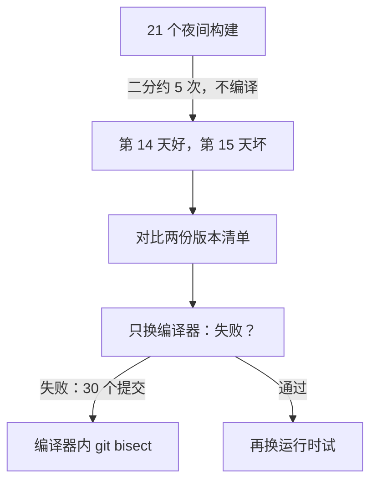

## Q
一个多组件软件栈（编译器、运行时、固件各在自己的仓库）出了回归，已知 3 周前的夜间构建是好的。直接对提交做 `git bisect` 有什么困难？怎样"按构建二分"？

## A
**直接对提交二分的困难**：
- **构建太贵**：每个中点都要重新编译整个栈，可能一小时以上；
- **多个仓库**：问题可能在编译器，也可能在运行时，`git bisect` 一次只能在一个仓库里走；
- **组合不确定**：编译器的某个旧提交应该配运行时的哪个提交？随手配一个组合，测到的可能是一个从未存在过的版本组合。

**按构建二分：先在已有的制品上二分，再在提交上二分**。

1. **在夜间构建之间二分**：每天的夜间构建都保存了制品和版本清单。3 周是 21 个构建，二分约 5 次（2⁵ = 32），每次只需下载制品并运行测试，不用编译。结果：回归出现在第 14 天和第 15 天的构建之间。
2. **对比两个清单，确定是哪个组件变了**：这两天之间编译器变了 30 个提交，运行时变了 12 个，固件没变。
3. **逐个替换组件**：以第 14 天的组合为底，只把编译器换成第 15 天的版本。失败 → 问题在编译器；通过 → 换运行时试。
4. **在那个组件的提交区间里用 `git bisect`**：30 个提交约 5 次，其他组件固定在第 14 天的版本。

总共约 5 + 1–2 + 5 次测试，而不是在几百个跨仓库提交里盲目查找。

**真实工具的同样思路**：Firefox 的 `mozregression --good 2014-12-25 --bad 2015-01-07` 先下载已构建好的夜间版本二分，缩小到一天后，再在更细的集成构建上继续二分。

**前提条件**（要在平时准备好）：
- 每个夜间构建的制品和版本清单保留足够长的时间（例如 60 天）；
- 测试环境能按清单指定每个组件的版本；
- 提交后流水线如果每次合入都出制品，就能直接在这些制品上二分到单个提交，完全不用重新编译。
