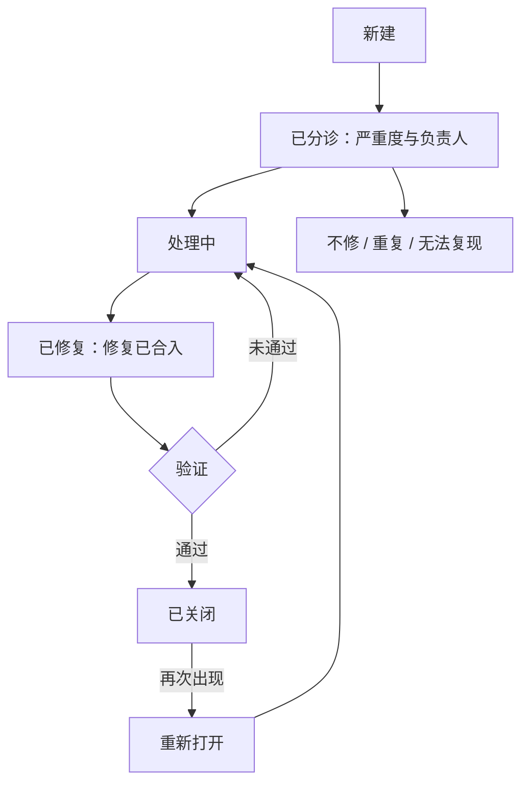

## Q
缺陷从提出到关闭经过哪些状态？为什么"修复合入"不等于可以关闭？

## A

- **新建**：报告人提交，信息齐全。
- **已分诊**：确认是有效缺陷，评定严重度和优先级，指派负责人和目标版本。
- **处理中**：负责人在分析和修复。
- **已修复**：修复已经合入（写明合入的提交和分支）。
- **验证**：由报告人或测试方，在**包含修复的构建**上执行原来的复现步骤，确认问题消失。
- **已关闭**：验证通过。
- **重新打开**：之后再次出现，例如修复不完整或被后续改动破坏。
- **不修 / 重复 / 无法复现**：要写明理由；"重复"要链接到原单。

**为什么"已修复"不等于关闭**：
- **修复可能无效**：修复针对的是推测的原因，实际原因是另一个；
- **修复可能只进了一个分支**：主干修了，发布分支没有挑拣，或者反过来；
- **修复可能被构建遗漏**：合入了，但测试的那个构建没包含它；
- **没有防退化**：以后有人改回去，没有测试能发现。

**关闭的条件**（通常都要满足）：
1. 在包含修复的构建上复现步骤通过，附上运行链接；
2. **加了一条回归测试**：在修复前的版本上失败、修复后通过，并放进最低能稳定抓到它的那一档；
3. 所有受影响的分支都已覆盖，或明确说明某分支不修；
4. 如有失败签名，关联到这张单，以便修复后再出现时自动重新打开。

**统计用途**：各状态停留的时间（例如从新建到已分诊、从已修复到关闭）能暴露流程瓶颈；重新打开率反映修复质量。
