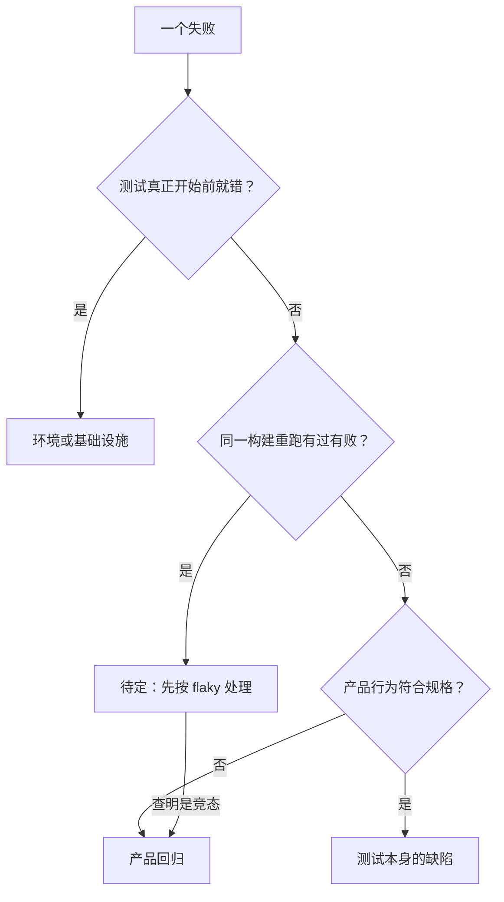

## Q
一个测试失败可以归为哪四类？每一类的典型证据和处理方式是什么？

## A
| 类别 | 典型证据 | 处理方式 |
|---|---|---|
| **产品回归** | 某个提交之后稳定失败；在任何健康机器上都能复现；最后一次通过的版本上重跑仍通过 | 找出引入的改动，主干上回滚或修复；发布分支上进入阻断项分诊 |
| **不稳定（flaky）** | 同一构建重跑时有过有败；失败没有对应的代码改动；失败率长期在某个水平 | 记录不稳定率，隔离测试，指派负责人限期修复根因 |
| **环境或基础设施** | 错误发生在测试真正开始之前（设备申请失败、依赖下载失败、磁盘满）；失败集中在某台机器或某个时间段；多个无关测试同时失败 | 交给基础设施团队；坏机器下线；不计入产品失败率；在健康环境上重跑得到真实结果 |
| **测试本身的缺陷** | 产品行为符合规格，测试的期望错了；测试在改动前后都不该通过；测试依赖了执行顺序或写死的时间 | 修测试，由测试的负责人处理；修之前要确认产品行为确实正确 |

**为什么分类重要**：
- **决定谁来处理**：分错类，问题被送到错误的团队，来回转手浪费时间。
- **决定统计口径**：通过率、不稳定率、基础设施错误率分别统计，才能看清质量趋势。只看一个"失败率"，无法知道是代码变差了还是机器变差了。
- **决定紧急程度**：产品回归会进入用户手中；环境问题只影响测试本身。

**一条失败可能同时有两个标签**：例如一个间歇性失败最后查明是产品里真实的竞态条件（两个线程的执行先后不同导致结果不同），那它是"表现为不稳定的产品缺陷"，应该按产品回归处理。所以 flaky 是症状，不是根因；分类要以根因为准，查明之前标为"待定"。
