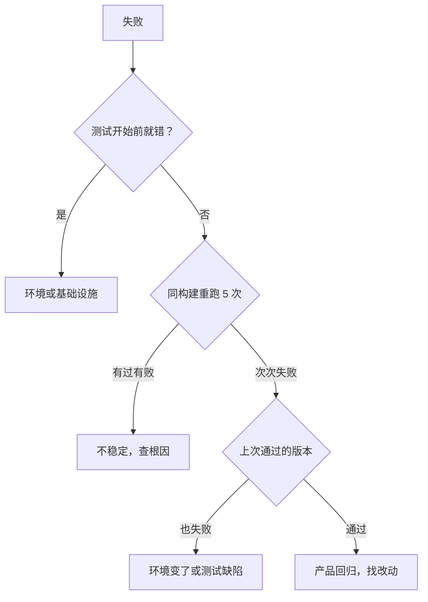

## Q
拿到一个失败，用什么样的操作顺序判断它属于产品回归、不稳定、环境问题还是测试缺陷？

## A
**思路：每一步做一个便宜的实验，排除一类可能**。

1. **看失败发生在哪个阶段**：在设备申请、依赖安装、服务启动阶段就失败（JUnit 结果中通常是 `error` 而不是 `failure`），多半是环境问题。再看同一时间、同一台机器上是否还有别的无关测试失败。
2. **同一构建重跑几次**（例如 5 次），最好换一台机器：
   - 有过有败 → 不稳定；但还要问：失败是不是从某个提交之后才开始出现？是的话，可能是新引入的竞态，按回归处理。
   - 次次失败 → 继续第 3 步。
3. **在最后一次通过的版本上重跑**：
   - 旧版本现在也失败 → 代码之外的东西变了：环境（依赖、驱动、固件、外部数据）或测试本身（期望值、日期、过期的证书）。
   - 旧版本通过、新版本失败 → 产品回归或测试改动导致，看这段区间改的是产品代码还是测试代码，然后二分。
4. **区分测试缺陷**：对照规格，确认产品的新行为是否其实是正确的（例如有意的行为变更没同步到测试）。

**每一步把结果写进缺陷单**，下一个接手的人不用重做。
