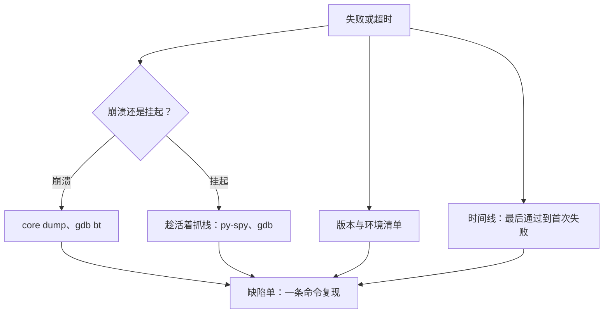

## Q
分诊一个失败（尤其是挂起或崩溃）时，要收集哪些证据，才能让负责人不需要再来问你？用什么命令收集？

## A
**原则：负责人拿到缺陷单，不需要重新跑一遍就能开始分析**。

**版本与环境**：
- 制品摘要和版本清单（各组件的提交、固件、驱动版本）；
- 机器编号、硬件型号；操作系统和内核版本（`uname -a`）；
- 测试命令行和配置、随机种子。

**时间线**：
- 最后一次通过的运行和第一次失败的运行，以及两者之间的改动列表（`git log --oneline <通过>..<失败>`）；
- 重跑结果：同一机器、另一台机器各重跑一次，结果如何。

**失败现场**：
- 测试日志、被测服务日志；时间点前后的系统日志：`dmesg -T`（内核消息，例如进程被内存不足机制杀掉、设备报错）、`journalctl --since "10 min ago"`；
- **崩溃**：core dump 文件和对应的二进制，`gdb <程序> <core>` 后 `bt` 看崩溃时的调用栈；
- **挂起**：趁进程还活着抓现场，比杀掉后猜原因有用得多：
  - Python 进程：`py-spy dump --pid <pid>` 打印每个线程当前的调用栈，不需要停止进程；
  - 原生进程：`gdb -p <pid> -batch -ex "thread apply all bt"`；
  - Go 进程：发送 `SIGQUIT` 让它打印所有 goroutine 的栈；
  - 看它在等什么：`top -H -p <pid>` 看线程 CPU，`ls -l /proc/<pid>/fd` 看打开的文件和连接；
- 设备状态：设备厂商的状态工具输出（例如 `nvidia-smi` 显示的显存占用和错误计数）。

**自动化**：这些都应由测试框架在失败或超时时自动收集，打包成附件链接到结果，而不是靠分诊的人事后登录机器。挂起类失败尤其如此：超时处理程序先抓栈、再杀进程。

**缺陷单里写清楚**：期望结果、实际结果、复现步骤（一条命令）、复现频率、证据链接。
