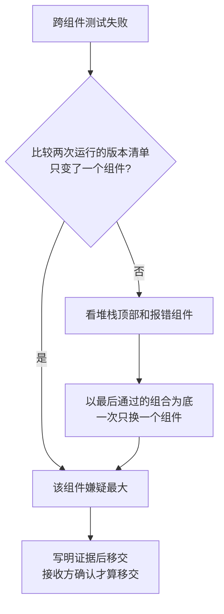

## Q
一个跨组件的端到端测试失败了，怎样判断该指派给哪个团队？定位不清时由谁负责？

## A
**可用的线索，按可靠程度排序**：
1. **失败开始时的改动**：最后一次通过和第一次失败之间只改了运行时，那就是运行时的嫌疑最大。组件各自出版本时，比较两次运行的版本清单，看哪个组件变了。
2. **崩溃或报错的位置**：堆栈的最顶上几帧属于哪个模块；错误信息由哪个组件产生。注意报错的组件不一定是出错的组件：运行时报"非法指令"，可能是编译器生成了错误的程序。
3. **逐个替换组件**：以最后一次通过的组合为底，一次只换一个组件到新版本，看哪次替换后失败。
4. **测试的归属**：测试元数据里的负责人和组件。它只说明谁写的测试，不说明谁的代码有问题，所以优先级最低。
5. **代码负责人文件**：`CODEOWNERS` 按路径列出负责人，堆栈指向的文件可以直接映射到团队。

**定位不清时**：
- **集成测试方暂时负责**：在定位到组件之前，由分诊的人（集成或发布测试团队）持有缺陷单，继续缩小范围。不要把一张"可能是你们的"单子同时发给三个团队，结果是没人动。
- **设定移交条件**：有足够证据指向某个组件（例如替换实验、二分结果）才移交；移交时写明证据，接收方确认后才算移交成功。
- **被退回时**：接收方认为不是自己的问题，必须给出反证（例如"换回旧版运行时仍然失败"），而不是一句"不是我们"。

**避免"踢皮球"的度量**：缺陷单在团队之间转手的次数。转手超过两次的单子，说明分诊证据不够，应回到集成方继续定位。
