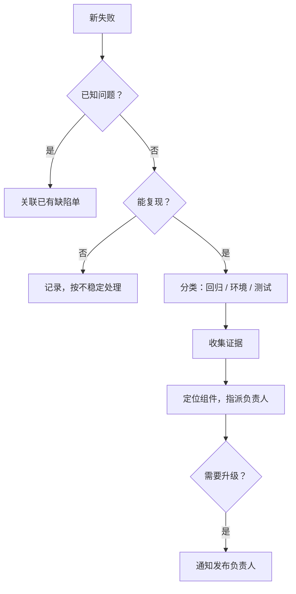

## Q
夜间测试或发布验证跑出一批失败，第一轮分诊（first-pass triage）的固定流程是什么？每一步要回答什么问题？

## A
**目标**：在最短时间内把每个失败变成"已知问题的又一次出现"或"一张证据齐全、指派给正确负责人的新缺陷单"。第一轮分诊不负责修复，也不一定找到根因。

1. **去重：是不是已知问题？** 用失败签名（错误信息和堆栈的指纹）匹配已有缺陷单；匹配上就关联，计数加一，不重复分诊。一晚上 60 个失败，常常只对应 5–8 个原因。
2. **能不能复现？** 在同一构建、同一类机器上重跑。能复现才往下走；不能复现的按不稳定处理，但要记录，出现次数多了仍然要查。
3. **分类**：产品回归、不稳定、环境或基础设施问题、测试本身的缺陷。四类的处理人不同。
4. **收集证据**：版本清单、机器、日志、最后一次通过和第一次失败的运行、重跑结果。
5. **定位组件、指派负责人**：从堆栈、失败的测试归属、最近的改动判断组件；指派给具体的人或团队，而不是"大家看看"。
6. **判断是否升级**：阻断发布、影响面大、数据或安全问题，立即通知发布负责人。

**时间盒**：每个失败在第一轮里花的时间设上限（例如 30 分钟）。到时间还定位不到组件，就带着已有证据交给最可能的团队，或升级。
