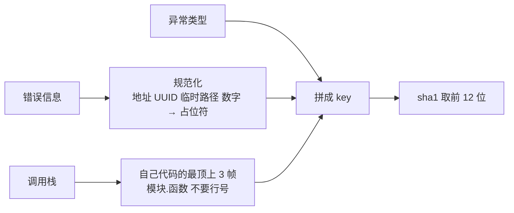

## Q
什么是失败签名（failure signature）？怎样从错误信息和调用栈计算出一个稳定的签名？写一个简化的实现。

## A
**失败签名**：从一次失败里提取出的指纹（fingerprint），同一个原因导致的失败得到相同的签名，不同原因得到不同的签名。有了它，就能把今晚的 60 个失败自动归成几组，并和已知问题对上。

**难点：原始信息里有很多"每次都不一样"的部分**：内存地址、时间戳、临时目录名、请求编号、具体数值、行号（代码一改就变）。直接对原文做哈希，同一个问题每次都是新签名。

**做法：先规范化，再取关键部分，再哈希**：
1. **规范化错误信息**：把数字、十六进制地址、UUID、路径中的临时部分替换成占位符；
2. **取异常类型**：例如 `TimeoutError`、`AssertionError`；
3. **取调用栈中属于自己代码的最顶上几帧**，只保留模块和函数名，不要行号；跳过标准库和测试框架的帧；
4. **组合后哈希**。



```python
import hashlib, re

def normalize(msg: str) -> str:
    msg = re.sub(r"0x[0-9a-fA-F]+", "<ADDR>", msg)
    msg = re.sub(r"[0-9a-f]{8}-[0-9a-f-]{27}", "<UUID>", msg)
    msg = re.sub(r"/tmp/\S+", "<TMP>", msg)
    msg = re.sub(r"\d+(\.\d+)?", "<N>", msg)
    return msg.strip()[:200]

def signature(exc_type, msg, frames, own_prefix="mystack.", top=3):
    mine = [f"{f.module}.{f.function}" for f in frames
            if f.module.startswith(own_prefix)][:top]
    key = "|".join([exc_type, normalize(msg), *mine])
    return hashlib.sha1(key.encode()).hexdigest()[:12]
```

例：`TimeoutError: request 8812 timed out after 30.0s at 0x7f3a...` 规范化为 `TimeoutError: request <N> timed out after <N>s at <ADDR>`，不同请求编号和地址得到同一个签名。

**栈帧比错误信息更可靠**：错误信息常常带着变化的内容，或者太笼统（例如所有超时都是同一句话）；而"在哪个函数里出错"通常稳定得多。错误追踪工具 Sentry 的默认分组也是优先看栈帧，没有栈时才退回异常类型和信息。
