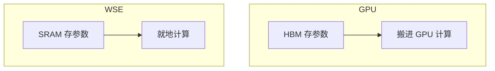

# 01 · 公司简报（Cerebras Systems · AI Inference Core）

Cerebras 做一种特别大的 AI 芯片：别人把一块硅晶圆切成几十上百块小芯片，它把整块晶圆做成一块芯片。它用这种芯片卖"让大语言模型回答得特别快"的服务，客户里最大的是 OpenAI。这份简报先用白话讲清 AI 推理是什么、为什么慢、为什么整块晶圆能让它变快，再讲 Cerebras 的产品、财务、OpenAI 合同、客户集中度和竞争对手。你不需要任何 AI 背景：每个术语第一次出现都有一句白话定义。最后一节是可以在面试里直接说出口的事实清单。

## 0. 一页结论

1. Cerebras 卖两样东西：**晶圆级芯片做成的机器**（CS-3、CS-4），和**跑在这些机器上的推理云服务**（按 token 收费的 API）。收入重心正在从卖机器转向卖云服务。
2. 它快的原因只有一个核心：生成每个字都要把模型的全部参数读一遍，**读得快就生成得快**。Cerebras 把参数放在芯片上的 SRAM 里，读的速度是 GPU 外挂内存的几千倍。
3. 代价也只有一个核心：芯片上的内存**容量小**（每块 44 GB），大模型要拆到几块甚至几十块晶圆上，晶圆之间要传数据。这让软件栈很复杂，也是你这个岗位存在的原因。
4. 2026 年 5 月在纳斯达克上市（代码 CBRS）。OpenAI 合同承诺 750 MW、价值超过 200 亿美元，是增长引擎，也是最大的集中度风险。
5. 对手是 Nvidia（以及它授权的 Groq 设计）、AMD、Groq、SambaNova 和云厂商自研芯片。AMD 和 AWS 同时也是合作伙伴。

---

## 1. AI 推理，从零讲

### 1.1 模型就是一个带很多参数的函数

- **模型（model）**：一个把输入变成输出的函数。里面有大量可调的数字，叫**参数**或**权重**（parameters / weights）。
- **训练（training）**：用海量数据反复调整这些数字，让输出变好。很贵，做一次就够。
- **推理（inference）**：参数固定不变，拿模型去回答用户的问题。每个用户、每次请求都要做，是 Cerebras 现在主要卖的东西。
- 规模的说法："70B 模型"= 有 700 亿个参数。每个参数用 16 位（2 字节）存，70B 模型就要 140 GB。

### 1.2 大语言模型一次只生成一个 token

- **token**：模型处理文字的最小单位，大约是一个英文单词或半个单词、一两个汉字。
- **大语言模型（LLM, large language model）**：输入一段 token，输出"下一个 token 是什么"。
- 回答一句话要循环很多次：生成第 1 个 token → 把它接到输入后面 → 再算第 2 个 → ……直到生成结束符。
- 所以一次请求分两个阶段：

| 阶段 | 做什么 | 卡在哪 |
|---|---|---|
| **预填充（prefill）** | 一次性读完用户的整段输入 | 计算量大，卡在**算力** |
| **解码（decode）** | 一个一个地生成输出 token | 每一步都要把全部参数读一遍，卡在**搬数据** |

- **KV 缓存（KV cache）**：解码时，模型把前面每个 token 算过的中间结果存起来，后面直接用，不用重算。它也占内存，对话越长占得越多。

### 1.3 为什么解码卡在"搬数据"

- **GPU**：有成千上万个并行乘法单元的芯片，是今天跑 AI 的主流硬件（Nvidia 是最大厂商）。
- **HBM（high-bandwidth memory）**：贴在 GPU 旁边的大容量内存，参数平时放在这里，计算时搬进芯片。
- **SRAM**：芯片内部的小块高速存储。离计算单元最近、最快，但很贵、很小。
- **内存带宽（memory bandwidth）**：每秒能从内存搬多少字节到计算单元。

用一个 8B 模型手算一遍（16 位，参数共 16 GB）：

| | 每秒能搬 | 读一遍 16 GB 要 | 一个用户每秒最多生成 |
|---|---|---|---|
| 一块 GPU 的 HBM（约 3 TB/s） | 3 TB | 约 5.3 ms | 约 190 个 token |
| 一块 WSE-3 的片上 SRAM（21 PB/s） | 21,000 TB | 约 0.0008 ms | 不再卡在这里 |

- GPU 那一行是上限，实际更低：每生成一个 token 都要把 16 GB 搬一遍，搬完才能算下一个。
- Cerebras 2024 年发布推理服务时，同样大小的 Llama 3.1 8B 跑到每秒 1,800 个 token，正好落在 GPU 这条上限之外。
- **tok/s**（tokens per second）：每秒生成多少 token，是"快不快"的基本单位。人读文字每秒只读几个词，所以几百、几千 tok/s 的意义在于：AI 代理（agent，自己连续调用模型干活的程序）一次任务要生成成千上万个 token，速度直接决定等多久。

---

## 2. Cerebras 卖什么

### 2.1 芯片：WSE-3

- **晶圆（wafer）**：一张直径 30 cm 左右的圆形硅片。普通做法是在上面刻很多块芯片，再切开分别封装。
- **WSE（Wafer-Scale Engine）**：Cerebras 不切，把整块晶圆当一块芯片用。JD 里的说法是"比 GPU 大 56 倍"。
- WSE-3 的关键数字：

| 项目 | 数字 | 白话 |
|---|---|---|
| 晶体管 | 4 万亿 | 规模 |
| AI 核心 | 900,000 | 很多小计算单元，排成二维网格，每个只和上下左右的邻居通信 |
| 片上 SRAM | 44 GB | 参数放在这里，不用去外面搬 |
| 内存带宽 | 21 PB/s | Cerebras 说是 H100 GPU 的 7,000 倍（比的是 SRAM 对 HBM） |
| 峰值算力 | 125 PFLOPS | 这是稀疏口径；**FLOPS** = 每秒浮点运算次数 |

### 2.2 系统与机柜

- **CS-3**：一块 WSE-3 装成的一台机器，2024 年发布，仍是主力。
- **CS-4（Nexus 平台）**：一个机柜放 3 块加强版晶圆（WSE-3T），2026 年第三季度开始出货；厂商说法是速度为 CS-3 的 2 倍。
- 路线图：WSE-5 已经从工厂回来、在做系统测试；CS-5 目标 2027 年夏天。

### 2.3 推理云：按 token 卖速度

- **推理云（Cerebras Inference / Cerebras Cloud）**：开发者用 API 调模型，按 token 计费。
- **API 与 OpenAI 兼容**：地址是 `https://api.cerebras.ai/v1`，用 OpenAI 的客户端只改密钥、地址和模型名就能调用；支持流式输出、工具调用、结构化输出（按给定的 JSON 格式回答）。
- 两种卖法：**共享推理**（公共模型，大家共用）和**专属推理**（dedicated endpoint，给一个客户专门部署）。
- 公开速度：`gpt-oss-120b` 约 3,000 tok/s；OpenAI 的 GPT-5.6 Sol 750 tok/s；Kimi K3.1（2.8 万亿参数）最高 2,000 tok/s。
- 渠道：自家云、AWS 与 Microsoft 应用市场、IBM watsonx、OpenRouter、Hugging Face，以及本地部署。

### 2.4 训练（了解即可）

- 训练用另一种模式，叫**权重流式（weight streaming）**：参数放在片外的 MemoryX，按层流进晶圆；多台机器之间用 SwarmX 广播参数、汇总梯度。
- 推理正好相反：参数**常驻**在片上 SRAM。面试里讲推理就够了。

---

## 3. 为什么晶圆级推理快，又难在哪

### 3.1 快：参数就在计算单元旁边

- GPU：每生成一个 token，参数从 HBM 搬进芯片一次，带宽每秒几 TB。
- WSE：参数分散存在 90 万个核心旁边的 SRAM 里，每个核心只算自己那一份，没有"搬进来"这一步。
- 结论：解码不再卡在搬数据上，单个用户的速度上去了。

### 3.2 难：容量小，大模型要跨很多块晶圆

- 一块晶圆 44 GB。70B 模型用 16 位存是 140 GB，至少要 4 块（140 ÷ 44 ≈ 3.2）。Cerebras 说 70B 最少 4 台、20B 1 台就能放下。
- 拆法是**按层切**：模型由几十层组成，每块晶圆放连续的几层；一个 token 算完自己那几层，只把中间结果（激活值，activations）传给下一块晶圆。这叫**流水线（pipeline）**。
- 超大模型更夸张：约 3 万亿参数的 Kimi K3 用 4 位存参数，需要 **59 块晶圆**。每多一块就多一跳网络、多一个流水线阶段、多一个要放 KV 缓存的地方。
- **长对话**：KV 缓存和参数挤同一块 44 GB，所以对话长度和同时服务的用户数都受限。
- **量化（quantization）**：用更少的位数存参数（16 位 → 8 位或 4 位），省空间但可能影响回答质量。Cerebras 对外说：共享推理只对**权重**做选择性量化，激活值、注意力和 KV 缓存保持全精度。

### 3.3 一种新做法：预填充和解码分开跑

- 预填充卡在算力，解码卡在搬数据，两者需要的硬件不一样。
- **分离式推理（disaggregated inference）**：预填充放在 GPU 或 AWS 的 Trainium 上，解码放在 WSE 上，中间把 KV 缓存传过去。
- 合作方：AWS（Trainium 做预填充，通过 Amazon Bedrock 提供）和 AMD（Helios 机柜做预填充）。

### 3.4 这和你的岗位有什么关系

一个请求要穿过：API → 路由 → 运行时 → 编译好的模型 → 几十块晶圆 → 晶圆间网络 → 主机。任何两层之间的版本、配置、内存、调度没对齐，都可能出错，而且错误常常不在报错的那一层。**跨层集成测试**就是在发布前把这类错误找出来。

---

## 4. 财务

| 指标 | 数字 |
|---|---|
| 上市 | 2026-05-14，纳斯达克 CBRS；发行价 $185，募资 $5.55B；首日开盘 $385、收盘 $311 |
| 员工 | 708 人（2025 年底），总部 Sunnyvale，研发在加拿大和印度也有 |
| 年收入 | 2024 年 $290.3M → 2025 年 $510.0M（+76%）；2025 年净利润 $237.8M |
| 2026 Q3 收入 | $210.8M（同比 +55%），其中云服务 $141.9M（+265%），硬件 $68.9M |
| 2026 Q3 毛利率 | GAAP 20%，调整后 41% |
| 2026 Q3 净利润 | GAAP 亏损 $161.2M |
| 现金 | $7.8B |
| 在手订单（RPO） | $26.1B，大部分来自 OpenAI |
| 全年指引 | 2026 年调整后收入 $940–960M；CEO 预计 2027 年收入翻三倍 |

- **RPO（remaining performance obligations）**：已经签了合同、还没确认的收入，可以理解成"在手订单"。
- **GAAP 与调整后（core / non-GAAP）**：GAAP 是会计准则下的正式数字；调整后剔除了股票薪酬等项目，公司更愿意讲这个。
- 趋势：Q1 云服务占收入约 43%（$82.8M / $193.4M），Q3 约 67%（$141.9M / $210.8M）。公司正在从"卖机器"变成"卖云"。
- 毛利低的原因：建数据中心、为 OpenAI 部署容量要先花钱；Q1 财报后股价因毛利指引跌了一成多。

## 5. OpenAI 合同：增长引擎，也是风险

| 条款 | 内容 |
|---|---|
| 规模 | 承诺 750 MW 的算力容量，可选再加 1.25 GW（总共 2 GW，到 2030 年底） |
| 价值 | 公司说超过 200 亿美元 |
| 交付 | 分批交付，每个园区有最低容量要求，还有物理与网络安全要求 |
| 违约 | 交付不达标或不满足 SLA，OpenAI 可以终止 |
| 贷款 | OpenAI 借给 Cerebras 10 亿美元营运资金，年息 6%，第一批 250 MW 交付后分 3 年还 |
| 认股权 | OpenAI 有约 3,345 万股的认股权，按贷款、市值、付款和交付里程碑归属 |
| 合作 | 共同设计未来模型；已上线 Codex-Spark（超过 1,000 tok/s）和 GPT-5.6 Sol（750 tok/s） |

- **MW（兆瓦）**：数据中心按耗电量算规模。合同用 MW 计，说明 Cerebras 要卖的是"建好的、插上电的数据中心容量"，不只是芯片。
- **SLA（service-level agreement）**：服务水平承诺，比如可用性、延迟。
- 风险：
  - **交付风险**：要按期建好数据中心并达到容量，否则对方可以终止。
  - **集中度风险**：一个客户占的份额越来越大（见下节）。
  - **排他条款**：和 OpenAI 等客户的合同限制向它们点名的竞争对手出售。
  - **可靠性就是合同**：SLA 写进了合同，发布质量直接连着收入。这是你在面试里可以用的一句话。

## 6. 客户集中度

- 2025 年：MBZUAI 占收入 62%、G42 占 24%，两家是关联方，合计 86%。2024 年 G42 一家占 85%。
- 2026 Q3：一个客户占 38%（与另一客户关联），另一个占 34%。
- 其他客户：Meta（Llama API）、Mistral、IBM、AWS、Oracle（2027 年接入 OCI）、Cognition、Lovable、Block、Figma、AlphaSense、GSK、CrowdStrike、Bilt。
- 解读：客户从"几乎只有中东一家"变成"OpenAI 加一批云厂商和企业"，但仍然很集中。

## 7. 竞争对手

| 对手 | 是什么 | 和 Cerebras 的关系 |
|---|---|---|
| **Nvidia** | GPU 霸主；2025 年底花约 200 亿美元非独家授权 Groq 的芯片设计，推出"GPU 做预填充、SRAM 芯片分担解码"的机柜 | 最大对手，开始卖和 Cerebras 同一思路的东西 |
| **AMD** | GPU 第二名 | 既是对手，也是合作方（Helios 做预填充）和投资人 |
| **Groq** | 另一家 SRAM 推理芯片公司，仍运营 GroqCloud | 直接对手 |
| **SambaNova** | 推理芯片 SN50 | 直接对手 |
| **Google TPU / AWS Trainium** | 云厂商自研芯片 | TPU 是对手；Trainium 在分离式推理里是合作方 |
| **云厂商与新云** | AWS、Azure、GCP、Oracle、CoreWeave | 卖推理服务的对手 |

| Cerebras 赢在 | Cerebras 弱在 |
|---|---|
| 单用户速度：第三方在 gpt-oss-120B 上测的首个回答 token 时间 1.79 s，Groq 4.63 s，SambaNova 5.85 s，Bedrock 19.58 s | 每块晶圆只有 44 GB，大模型要几十块晶圆 |
| 不依赖 HBM、先进封装和 3 nm 产能 | 长上下文受限，KV 缓存和参数挤同一块内存 |
| OpenAI 合同和 $26.1B 在手订单 | GAAP 毛利 14–20%；客户集中 |
| 速度快对 AI 代理和编程助手的价值很大 | 没有 CUDA 生态，模型要过 Cerebras 自己的编译器；共享推理只有 2 个模型 |

- **CUDA**：Nvidia 的 GPU 编程平台，绝大多数 AI 软件建在它上面。Cerebras 不用 CUDA，所以每个新模型都要经过自己的编译器和运行时，这正是"新模型上线要做大量集成测试"的原因。

## 8. 最近一年的新闻

| 时间 | 事件 |
|---|---|
| 2026-01 | 宣布 OpenAI 合同（750 MW） |
| 2026-02 | 10 亿美元 H 轮融资；和 OpenAI 上线 Codex-Spark |
| 2026-03 | 和 AWS 合作：Trainium 预填充 + CS-3 解码，进 AWS 自己的数据中心 |
| 2026-05 | 上市；推出 Multi-LoRA |
| 2026-07 | 和 AMD 宣布分离式推理 |
| 2026-08 | 发布 CS-4；成为 GPT-5.6 Sol 的首发伙伴；Q2 财报 |
| 2026-09 起 | Inference Core 招一批新岗位：发布验证与集成的技术负责人、你的这个 SDET、DevOps、基础设施工程师 |
| 2026-10 | 博客讲怎样把约 3 万亿参数的模型部署到 59 块晶圆上 |
| 2026-11-12 | Q3 财报：收入 $210.8M，RPO $26.1B；WSE-5 在系统测试；Oracle 和"两家新的超大云厂商"合作 |

- **LoRA**：一种轻量微调方式，只训练一小块附加参数。Multi-LoRA 就是同一个底座模型同时挂多个客户的定制小块。

## 9. 可以直接说出口的事实

> 只说这些数字。别报股价、别评论 OpenAI 交付进度、别猜毛利原因。

1. "Cerebras builds a wafer-scale chip: the whole wafer is one chip — **900,000 cores** and **44 GB of on-chip SRAM** on the WSE-3."
2. "Decode is memory-bandwidth-bound: every output token reads all the weights. Keeping weights in SRAM gives **21 PB/s** of bandwidth, which is why single-user speed is so high."
3. "The trade-off is capacity: a **70B** model needs at least **four** wafers, and a **3-trillion**-parameter model was deployed on **59** wafers, pipelined layer by layer."
4. "Public since **May 2026**. Q3 revenue was **$210.8M**, up **55%**, and cloud is now about **two-thirds** of it."
5. "OpenAI committed **750 MW**, valued at **more than $20B**; the backlog is **$26.1B**."
6. "Speeds on the public cloud: around **3,000 tokens/s** on gpt-oss-120b, **750** on GPT-5.6 Sol."
7. "CS-4 started shipping this quarter with **three** wafers per rack; WSE-5 is in system test."
8. "Disaggregated inference with **AWS** and **AMD**: prefill on their hardware, decode on the wafer."
9. 收尾句："Every extra wafer is another network hop, another pipeline stage and another place the KV cache has to fit, so the integration risk sits between the layers — which is what RIT is for."

## 延伸阅读

- Cerebras 博客：How we deploy trillion-parameter frontier models — https://www.cerebras.ai/blog/how-we-deploy-trillion-parameter-frontier-models-on-cerebras
- Cerebras 博客：Introducing Cerebras Inference — https://www.cerebras.ai/blog/introducing-cerebras-inference-ai-at-instant-speed
- 推理 API 文档 — https://inference-docs.cerebras.ai/resources/openai
