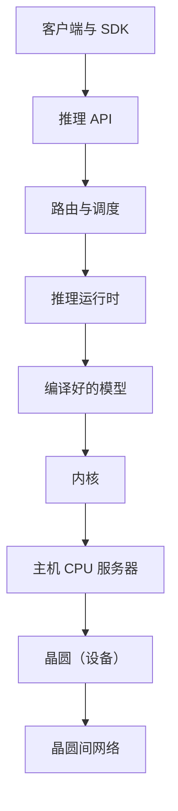

# 02 · 岗位与团队（AI Inference Core · Release Integration Testing）

你申请的是 Cerebras 推理软件核心团队里的高级测试开发工程师（SDET, Software Development Engineer in Test），所在的小组叫 Release Integration Testing（RIT，发布集成测试）。这个小组刚刚成立，任务是在各个功能合到一起之后、正式发布之前，证明"整条推理链路一起跑是对的"。这页讲团队在组织里的位置、RIT 管什么不管什么、推理软件栈每一层是什么、你一周大概做什么、要用哪些工具，以及它和其他测试岗位的区别。

## 0. 一页结论

1. 位置：**AI Inference Core → Release & Feature Qualification → Release Integration Testing**。工作地 Sunnyvale 或 Toronto，每周至少 3 天到办公室。
2. RIT 是**功能验证和发布验证之间的桥**：功能团队证明自己的功能单独能用；RIT 证明所有功能合在一起、穿过整条软件栈时还能用。
3. RIT 是**新建的**：公司同时在招一位技术负责人来"建立并领导"它。你很可能是第一批工程师，要从零搭流程和工具。
4. 这是**写代码的测试岗**："设计并开发可扩展的测试自动化、框架、诊断和工具，不只是执行用例"。主要语言 Python。
5. 成功的样子：跨层缺陷更早被发现、回归测试给出**可信、可行动的信号**、排查周期变短、发布更可预测。

---

## 1. 两个推理组织

| 组织 | 管什么 |
|---|---|
| **Inference Core**（你在这里） | 把模型跑在晶圆上的那一半：新模型上线（模型翻译、图降级、编译优化、运行时集成）、运行时、内核、ML 系统性能、推理算法研究、软件集成、**发布集成测试**、核心基础设施（Python 编排与测试基础设施、CI/CD、Kubernetes） |
| **Inference Service** | 面向用户的那一半：推理云后端（计费、配额、控制台）、平台（数据中心里的 Kubernetes）、推理 API、全球路由、GPU 推理（AMD 预填充）、可观测性，以及服务侧的质量团队（每周一次端到端发布验证） |

- **可能的经理**：同时在招的"AI Inference Core – Technical Lead Manager, Release Qual & Integration"，职责是"建立并领导 RIT"。也可能是 Release & Feature Qualification 的负责人。电话前问招聘官。
- 软件线的高管：Qi Jin（EVP Software）、Nish Sinnadurai（SVP Core Software，兼加拿大总经理，Toronto 办公室负责人）、Hagay Lupesko（SVP AI Cloud）、Sean Lie（CTO，联合创始人）、Andrew Feldman（CEO，联合创始人）。

## 2. 推理软件栈，每一层一句白话

一个请求从云端走到晶圆，大致经过这些层。服务侧（上半）归 Inference Service，晶圆侧（下半）归 Inference Core。

| 层 | 白话 | 典型出错方式 |
|---|---|---|
| **AI 框架**（framework） | 写模型用的库，主要是 PyTorch | 新模型用了没支持过的算子 |
| **编译器**（compiler） | 把 PyTorch 模型翻译成晶圆能跑的程序，决定每一层放在哪些核心上、数据怎么在核心间走 | 某种形状或数据类型下生成了错误的程序 |
| **内核**（kernel） | 在芯片上执行一个基本运算（矩阵乘、注意力）的底层小程序；Cerebras 用汇编和自家 C 风格语言 CSL 写 | 边界尺寸下数值算错 |
| **运行时**（runtime） | 程序跑起来时管资源的那层：把模型加载到设备、分配内存、调度请求、在主机和设备之间搬数据 | 内存没释放、调度死锁、长请求饿死短请求 |
| **主机与设备**（host / device） | 主机是普通 CPU 服务器，设备是晶圆；设备编程就是把程序和数据写进晶圆 | 主机软件和固件版本不匹配 |
| **分布式系统** | 多块晶圆、多台主机协作，按层组成流水线 | 一块晶圆慢了，整条流水线跟着慢 |
| **基础设施** | Kubernetes、CI/CD、集群管理与监控 | 环境不一致导致"在我这能过" |
| **硬件** | 晶圆、机器、网络、固件 | 某台机器的个别坏核心或链路 |

- **模拟器**（simulator）：没有真机器时，在普通电脑上模拟晶圆执行。JD 要你读"单元、模拟、基准、功能和集成测试的结果"，模拟器结果是其中一类证据。
- **基准测试**（benchmark）：在固定条件下量速度，比如 tok/s 和首个 token 的等待时间。

## 3. RIT 管什么、不管什么

| 归功能团队 | 归 RIT |
|---|---|
| 功能设计 | 推理核心的**集成策略** |
| 功能级验证 | **推理路径的就绪审批**（readiness approval） |
| 功能回归 | 跨层的**集成验证** |
| — | **首轮上线排查**（first-pass rollout triage） |

JD 和同组技术负责人职位里反复出现的词，每个一句白话：

| 词 | 白话 |
|---|---|
| **准入门**（readiness gate） | 一个版本进入发布前必须拿出的证据：单元、模拟、基准、功能、集成五类结果都有，覆盖不到的地方明确列出来 |
| **准入 / 准出标准**（entry / exit criteria） | 什么条件下可以开始验证、什么条件下算验证完 |
| **升级阈值**（escalation thresholds） | 问题到什么程度要拉更高层的人决定 |
| **master 与发布分支健康**（branch health） | 主干和发布分支上的测试有多稳定、多少是绿的、红了多久没人管 |
| **失败分类**（failure classification） | 每个失败判成：真回归、不稳定测试（flaky）、环境问题、基础设施问题、已知问题 |
| **区分 flaky 和真回归** | flaky = 代码没变、结果时好时坏的测试；真回归 = 新改动把原来能用的弄坏了 |
| **把覆盖放在正确的层** | 能在单元测试抓到的不放到端到端；只有跨层才出现的问题才放进集成测试 |
| **把耐用的功能测试晋升进发布回归** | 功能团队写的测试里，稳定、有价值的那部分搬进发布回归套件 |
| **首轮上线排查** | 新版本开始上线时第一个看失败的人：判断是哪一层的问题、派给谁 |
| **风险驱动测试**（risk-based testing） | 测试资源按"出错概率 × 出错代价"分配，而不是平均分 |

- RIT 的上游是 **Software Integration**（自称"创新引擎"）：把新功能快速拼起来的小分队，节奏快、优先级常变。RIT 自称"生产引擎"：把拼好的东西变成可靠的生产版本。
- RIT 的下游是服务侧的**每周发布验证**：RIT 要在那之前把跨层缺陷挡住。

## 4. 一周大概怎么过

下面是按职责推出来的合理图景，面试里当作"我的理解，请你纠正"来说。

| 时间 | 做什么 |
|---|---|
| 每天早上 | 看 master 和发布分支的夜间回归；给每个失败分类；真回归找出是哪次提交引入的（二分查找，bisect），开 bug、指派负责人 |
| 功能合入前后 | 读功能设计，列出它和运行时、内存、调度、模型执行的交互风险；补集成场景 |
| 发布周期 | 发布候选（RC, release candidate）切出 → 跑发布回归 → 汇总各类结果 → 写"能不能发、缺什么"的建议 |
| 上线时 | 首轮排查：失败归到哪一层、派给谁、要不要回滚 |
| 间隙 | 改测试框架、加诊断工具和看板、修 flaky、做代码评审、带新人 |

- 节奏：同组岗位明说"不是追求规律、可预测工作时间的岗位"，集成期会很紧张。CEO 公开说过不认同"每周 38 小时"的工作方式。
- 风气：公司鼓励在测试里用 AI 工具；他们写过用 AI 代理按自然语言测试云控制台的博客。

## 5. 工具与技术

| 档次 | 工具 | 一句话 |
|---|---|---|
| 必会 | **Python** | 测试、编排和工具的主语言 |
| 必会 | **pytest** | Python 测试框架；基础设施团队要求会写 pytest 扩展 |
| 必会 | **CI/CD** | 每次提交自动构建、测试、发布的流水线 |
| 必会 | **Linux 排查工具** | 日志、`gdb`（调试器）、`strace`（看进程在做哪些系统调用）、`pdb` |
| 应会 | **Kubernetes** | 容器编排；推理平台跑在上面 |
| 应会 | **Prometheus / Grafana** | 指标采集和看板；性能与健康门常用 |
| 应会 | **asyncio / 多进程** | 并发跑大量测试、处理超时、重试、取消 |
| 应会 | **Go** | JD 写"Python、Go 或类似语言" |
| 知道 | **PyTorch** | 写模型的框架；测试时用它算参考结果 |
| 知道 | **vLLM / SGLang** | 开源的 LLM 推理引擎，GPU 推理那条线用 |
| 知道 | **模拟器** | 没有硬件时跑晶圆程序 |
| 知道 | **C++** | 运行时和工具常用 |
| 知道 | **Jenkins、Bazel、Argo CD、Terraform、Helm** | 构建、部署和基础设施工具 |

## 6. 和其他测试岗位有什么不同

| 岗位 | 关注 | 和你的区别 |
|---|---|---|
| 功能团队的 SDET | 一个功能自己对不对 | 你看功能**之间**和层**之间** |
| 服务侧质量团队 | API、平台、云控制台的每周发布 | 你在它上游，看晶圆这一侧的推理核心 |
| ML API 质量 | 模型准确率、公平性、基准评测 | 你看的是"同一个模型换了软件版本还对不对" |
| GPU 推理 SDET | AMD GPU 预填充那条线 | 你看晶圆这条线 |
| AI 集群 SDET | 几千个节点的集群可靠性 | 你看推理软件栈的集成 |
| Core Infrastructure | 编排、执行引擎、测试基础设施平台本身 | 你是它最大的用户，在它上面写测试和工具 |

## 7. JD 的成功标准，对应你能说的话

| 成功标准 | 你的证据 |
|---|---|
| 交付稳健、可扩展的自动化，改进集成与发布验证 | 配置驱动的质量门框架，铺开 8 个数据域；个人项目 470+ 个测试文件、自托管 CI |
| 跨层缺陷更早被发现 | 静默 NULL 事故后补了跨"promote → fee"整条链路的端到端测试 |
| 回归测试给出可信、可行动的信号 | 用生产查询本身验证切换；拒绝把真问题加进排除名单 |
| 排查周期变短 | 交易追踪和可观测性（Sentry、Datadog）；7 分钟给出 Terraform 发布失败的根因 |
| 发布更可预测 | 部署与上线分开、默认关闭的开关、先影子比对再切换 |
| 带新人、提升工程质量 | 团队的新人上手文档（2024 年写，一直维护）；先定边界和契约再评审设计 |
