# 09 · 图解：一张一张看懂整套备考

这一页把整套备考画成 14 张图：面试流程、团队位置、发布流程、一次推理请求、晶圆为什么快、测试分层、分诊、两道带回家题、自我介绍和两周计划。每张图下面只有两三行，告诉你该看哪里。AI 的部分从零开始：先看第 4 张到第 8 张，再回去读公司简报，会轻松很多。面试前一天把整页从头到尾翻一遍，能对着每张图说出 30 秒，就算准备好了。

## 1. 面试流程：每一轮考什么

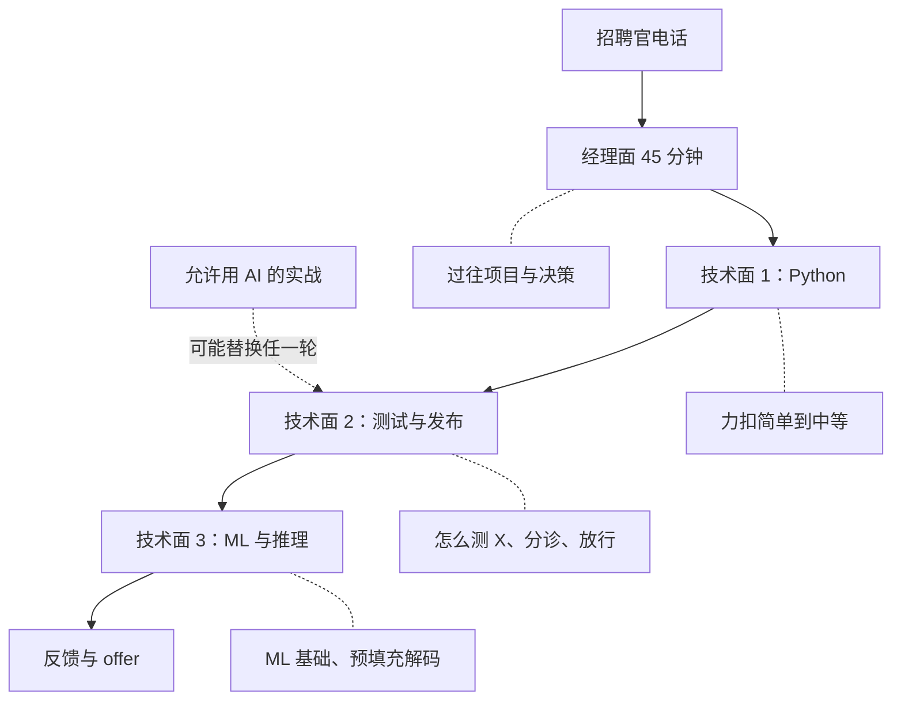

- 经理面最常问"你做过什么、为什么那样决定"，追问三层；可能夹一段"你会怎么测 X"。
- 三轮技术面每轮约 45 分钟，开头都先讲一个项目；编码在 HackerRank，视频在 Teams。
- offer 要 CEO 签字，反馈一般 24–48 小时。

## 2. 团队位置：RIT 夹在功能团队和发布验证之间

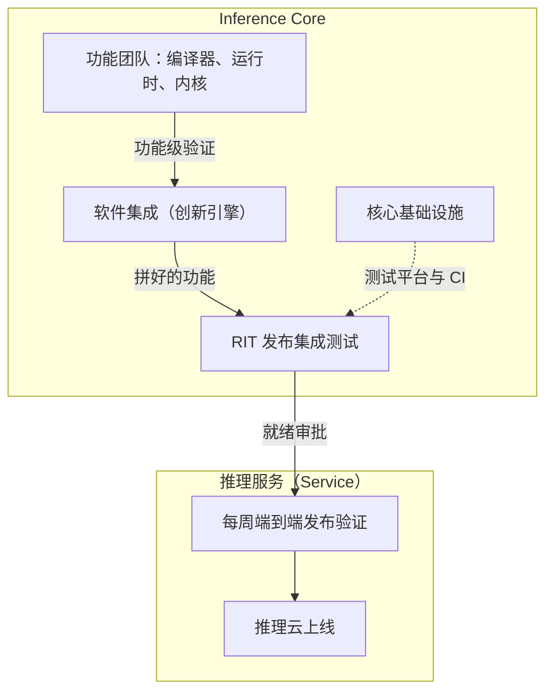

- 功能团队证明"自己的功能单独能用"；RIT 证明"合在一起、穿过整条栈还能用"。
- 软件集成自称"创新引擎"，RIT 自称"生产引擎"：前者拼得快，后者把它变成可靠的版本。
- RIT 是新建的，你很可能是第一批工程师；核心基础设施是你天天用的平台。

## 3. RIT 管的发布流程：从合入到上线

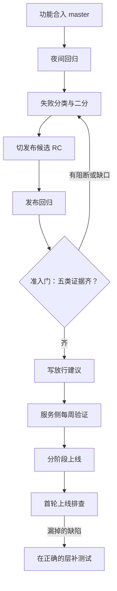

- 五类证据：单元、模拟、基准、功能、集成；覆盖不到的地方要写出来，不藏。
- 放行建议是 go / no-go 加证据，由发布负责人拍板。
- 最后一步回到测试：每个漏到线上的缺陷，都要在最低能抓住它的那一层补一个测试。

## 4. 一次推理请求的一生

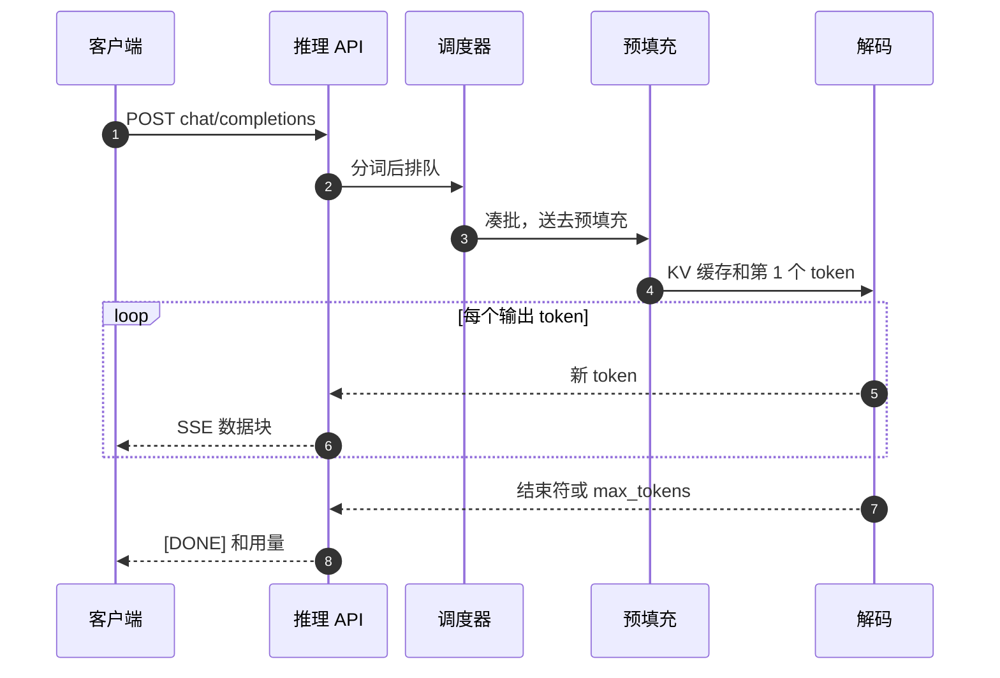

1. 客户端用 OpenAI 风格的接口发一组消息，要求流式返回。
2. API 做鉴权和限流，把文字切成 token（分词，tokenize），请求进队列。
3. 调度器把几个请求凑成一批（批处理，batching），一起送去计算。
4. 预填充一次算完整段输入，留下 KV 缓存，并得到第 1 个输出 token。用户等到这里的时间叫首个 token 时间（TTFT, time to first token）。
5. 解码每一步生成一个新 token。
6. API 立刻把它作为一个 SSE 数据块推给客户端，所以字是一段一段冒出来的。
7. 生成到结束符，或达到 `max_tokens` 上限，就停。
8. 最后发 `[DONE]` 和用量（输入、输出各多少 token），计费靠它。

## 5. 预填充和解码：为什么解码卡在带宽

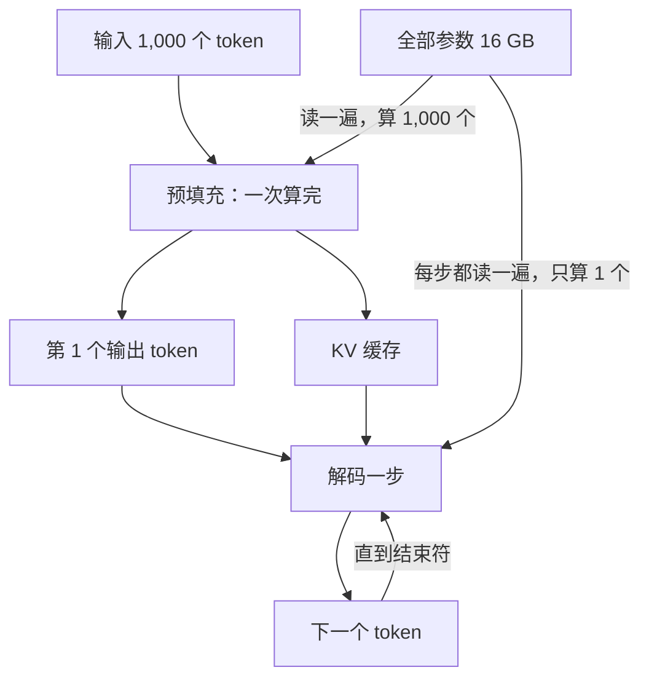

- 预填充：读一遍参数，算 1,000 个 token，计算多、搬运少，卡在算力。
- 解码：每读一遍 16 GB 参数只换来 1 个 token，搬运多、计算少，卡在内存带宽。
- 手算（8B 模型，16 位存，共 16 GB）：GPU 约 3 TB/s，读一遍约 5.3 ms，一个用户每秒最多约 190 个 token。

## 6. 内存层级：GPU 对晶圆的片上 SRAM

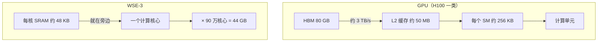

- GPU：参数住在 HBM，每生成一个 token 都要穿过 HBM 这条窄路搬进芯片。
- WSE：参数切成 90 万份，每份就放在用它的核心旁边，总带宽 21 PB/s，没有"搬进来"这一步。
- 代价是容量：一块晶圆只有 44 GB，比一块 GPU 的 HBM 还小。

## 7. 一个模型按层切到几块晶圆上（流水线）

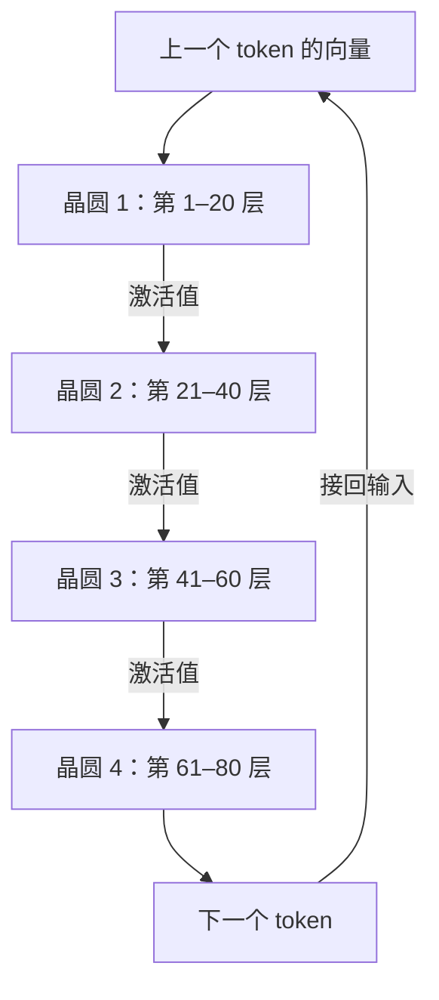

- 70B 模型用 16 位存是 140 GB，至少要 4 块 44 GB 的晶圆；按 80 层为例，每块放连续的 20 层。
- 晶圆之间只传中间结果（激活值，activations），参数不动；每块晶圆还要放自己那几层的 KV 缓存。
- 每多一块晶圆就多一跳网络、多一个流水线阶段：约 3 万亿参数的模型用了 59 块。错误常常出在两块之间。

## 8. 预填充和解码分开跑（分离式推理）

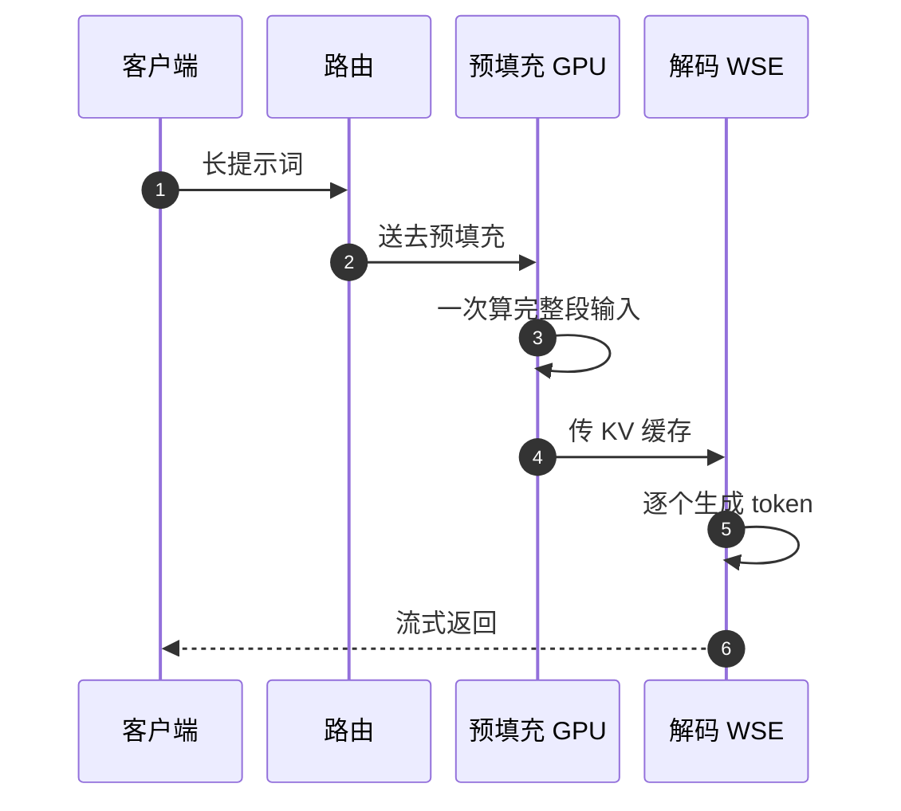

1. 客户端发来一段很长的输入。
2. 路由把它送到擅长算力的硬件：AWS 的 Trainium 或 AMD 的 Helios 机柜。
3. 预填充在那边一次算完，卡在算力，正好用对硬件。
4. 把 KV 缓存通过网络传到晶圆：这是两套硬件、两套软件之间新的接缝，格式、精度、版本都要对得上。
5. 晶圆做解码，卡在带宽，正好用上片上 SRAM。
6. 生成的 token 一路流式返回客户端。

## 9. 推理栈的测试分层

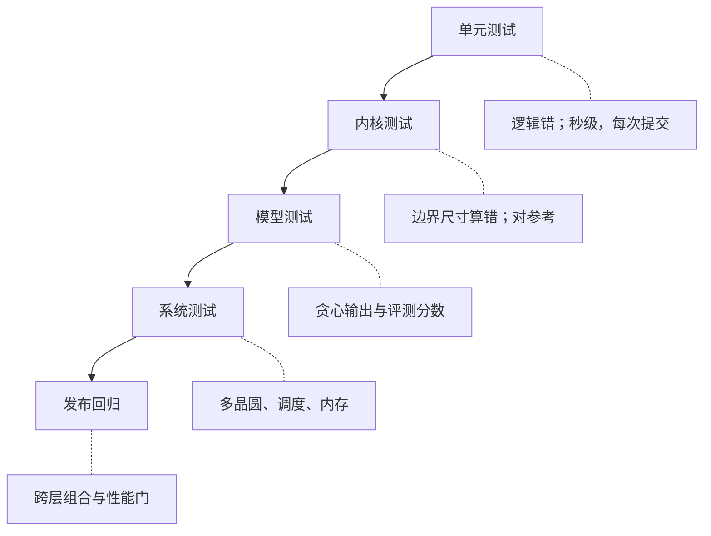

- 越往下越便宜、越快、越容易定位；越往上越慢、越贵，但只有它能抓跨层的问题。
- 规则：一个缺陷放在最低能抓住它的那一层；只有跨层才出现的问题才进集成和发布回归。
- 分档对应：单元每次提交跑，内核和模型每晚跑，系统和发布回归在切 RC 之后跑。

## 10. 第一轮失败分诊：决策树

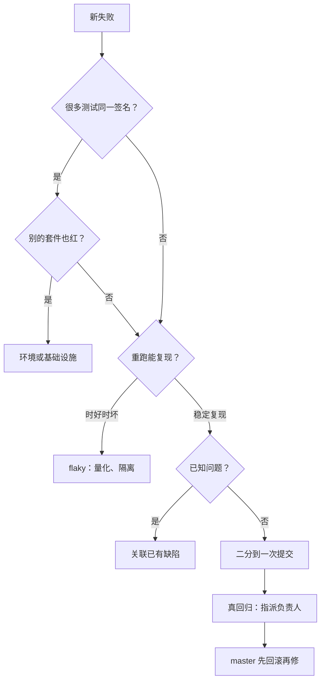

- 第一步不是看代码，是看"失败签名"：去掉数字、地址、时间戳之后相同的错误算一类。
- flaky 先重跑量出失败率，再隔离并设负责人和期限；重试只用来诊断，不当修复。
- 真回归用 `git bisect` 找到引入它的提交，按改动所在组件指派。

## 11. 带回家题之一：评测集剪枝

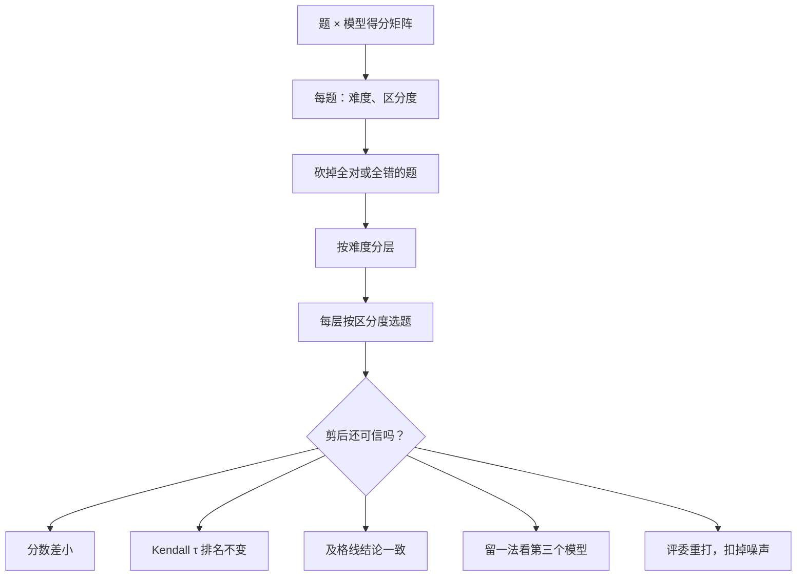

- 三个模型都对或都错的题，分不出谁好谁坏，最先砍。
- 只有三个模型就只有三对排序，"τ = 1"证据很弱，所以要留一法：用两个模型选题，看第三个结论是否保持。
- 评委是大模型，自己会抖；剪后分数的变化小于评委的波动，就不算差异。这就是回归套件分档和 flaky 的同一个问题。

## 12. 带回家题之二：性能扫描表 → 放行结论

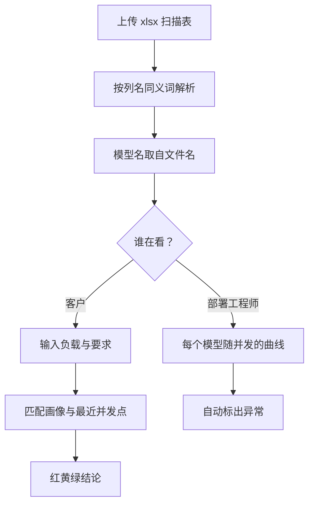

- 唯一能依赖的契约是文件名和列结构：不写死模型名单，换一个新模型 L 也要能显示。
- 客户只要一个红黄绿和他认得的数字（tok/s、TTFT），并且要告诉他"取了最近的实测点"。
- 工程师要看异常：吞吐随并发反而下降、TTFT 随负载变小、每用户速度 × 并发和总吞吐对不上。

## 13. 2 分钟自我介绍：时间线

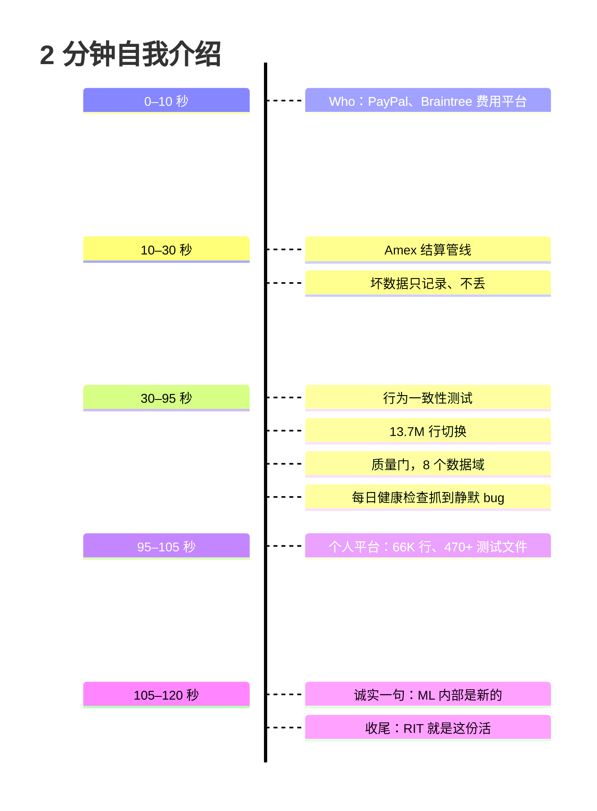

- 中间约 65 秒是重点：四件测试与发布的事，每件一句，能带数字就带。
- "ML 内部是新的"要主动说，说完马上接"我带来的是验证习惯"。
- 被打断就停；每段都能单独展开成 60 秒的项目深挖。

## 14. 两周计划

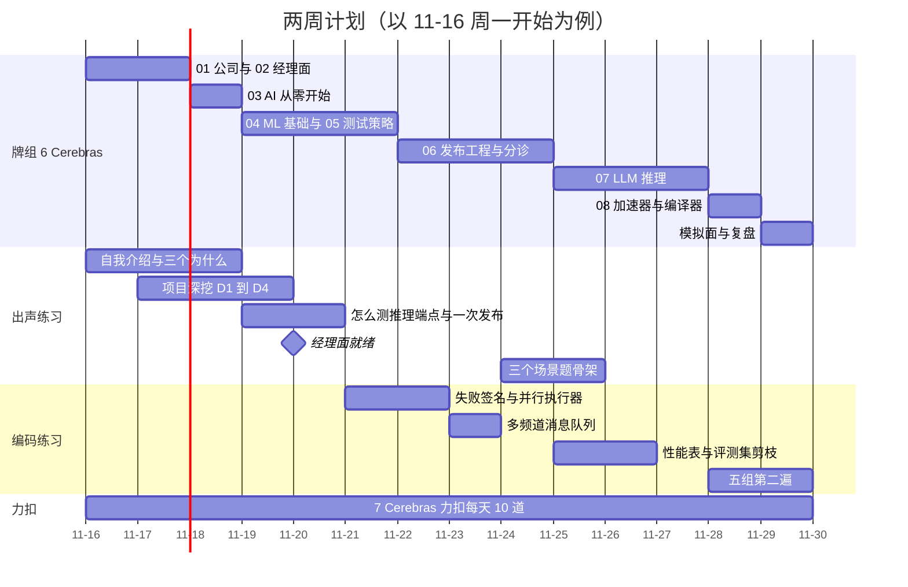

- 前 5 天只为经理面：01、02 全部过完，03 至少过到"推理服务在做什么"，自我介绍说出声 3 遍。
- 第二周给技术面：每天一组练习，限时做完再对照参考解；06 和 07 是卡最多的两部分，每天新卡不超过 60 张。
- 最后一天把这一页从头到尾讲一遍，每张图 30 秒。

## 延伸阅读

- [01-company-brief.md](01-company-brief.md)：第 1–3 节是第 4–8 张图的文字版。
- [02-role-and-team.md](02-role-and-team.md)：第 2 张图的团队和推理栈每一层。
- [04-hm-screen.md](04-hm-screen.md)：自我介绍逐字稿、项目深挖、"怎么测 X"。
- [06-technical-rounds.md](06-technical-rounds.md)：场景题骨架和两道带回家题的完整说明。
- [07-practice.md](07-practice.md)：五组可运行的练习。
