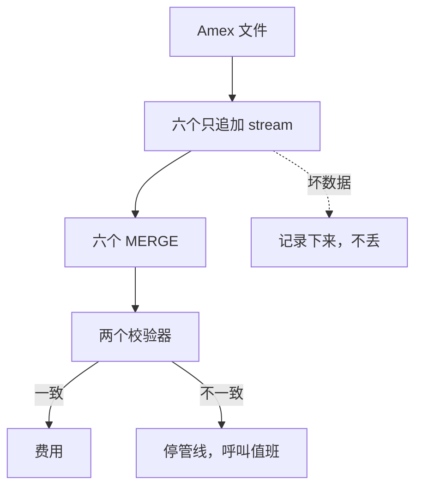

## Q
背景问题：Tell me about something you owned end to end / built without being asked. 怎么讲？

## A
- **First choice, S1 — owned end to end**:
  1. "I inherited a **stub with one table** and owned the Amex settlement pipeline from **design doc** to **18 months** of production."
  2. Six append-only streams, six `MERGE`s, two **validators**; **idempotent at three layers**.
  3. "**Bad data is recorded, never dropped**"; a mismatch **halts and pages** on-call — me.
  4. About **22M** Amex transactions in half a year.

- **Second choice, S7 — nobody asked**:
  1. "**No ticket, no owner**": tests collided on one shared schema.
  2. V1 → V2 with three ADRs; slots cloned from the **deployed commit** in about **2 seconds**.
- **Close**: "Ownership to me is **on-call for what I built**."

> 中文提示：S1 不说"top committer"、不说美元数；S7 先说是个人仓库。追问 exactly-once：at-least-once 加幂等写入就是 effectively once。
