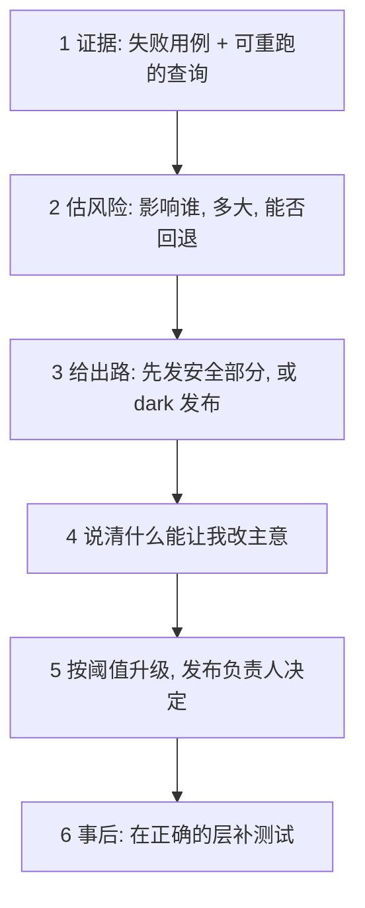

## Q
在进度压力下要推迟一次发布，你按什么顺序说「不」？（面试回答框架）

## A
1. **Evidence, not opinion**: "Here is the failing case, here is the query anyone can re-run."
2. **Size the risk**: blast radius — who is hit, how much, how reversible.
3. **Offer a path, not just a no**: ship the safe part now, gate the risky part; or ship **dark** behind a toggle.
4. **Name what would change my mind**: the specific test or number that would make it a go.
5. **Escalate by threshold, not by mood**: if the criteria say block, I raise it; the release owner decides.
6. **Afterwards**: add the test that would have caught it **at the right layer**.

> 中文提示：配 S6（分阶段上线）或 S5（默认关闭、先比对再切换）讲例子。这正对上 RIT 技术负责人职位里的"high-pressure release situations"和"escalation thresholds"。
