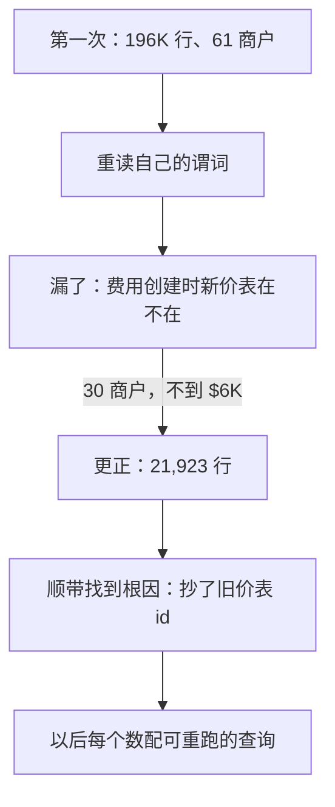

## Q
背景问题：Tell me about a mistake you made. 用 S10（公开撤回自己的数字）怎么讲？

## A
1. **Hook**: "I'd rather **retract my own number in public** than have a remediation sized off a bad predicate."
2. **Situation**: size the blast radius of wrong refund fees after a merchant moved to net settlement.
3. **Mistake**: my first query said about **196K rows, 61 merchants, ~$11K**.
4. **Caught it**: before anyone acted, I re-read my **predicate**: it never checked the new pricing schedule **existed when the fee was created**.
5. **Corrected**: **21,923 rows, 30 merchants, under $6K** — about **9×** fewer rows, about **1.9×** less money.

6. **Root cause found on the way**: the refund path **copied an old schedule id** instead of resolving at fee time.
7. **Changed since**: every number ships with a **re-runnable query**, and I say **when** each input is read.

> 中文提示：9 倍只适用于行数，金额约 1.9 倍。【待补：是什么让你重审谓词】
