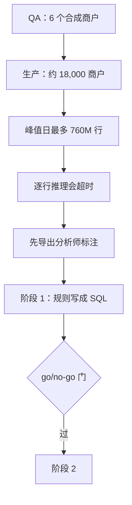

## Q
背景问题：Tell me about a time you pushed back on shipping. 用 S6（叫停逐行推理）怎么讲？

## A
1. **Boundary first**: "This was **capacity reasoning before anything shipped**, not profiling a running system."
2. **Situation**: an ML fee-anomaly detector had only run in QA on **6 synthetic merchants**; production is about **18,000 merchants**, up to **760M rows** on a peak day.
3. **The math**: the serving design was a **per-row** Python forward pass; **per-row cost × peak rows** would time out. QA could never show it.
4. **Protect what can't be rebuilt**: the **analyst labels**, exported first.
5. **Proposal**: Phase 1 only the **deterministic rule** as set-based SQL in the warehouse; Phase 2 behind a **go/no-go gate**; alerting and CI/CD **frozen** until then.

6. **Result**: a launch that could have **paged the team at night** became a **phased plan**.

> 中文提示：别说"I profiled it"、别把 10 µs 的示例当事实、别点名实习生。【待补：Phase 1 是否上线】
