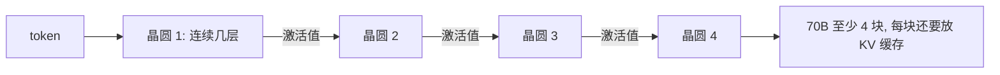

## Q
晶圆级推理的代价是什么？70B 模型要几块晶圆？3 万亿参数的模型呢？这和集成测试有什么关系？

## A
- **代价是容量**：一块晶圆只有 44 GB SRAM。
- **70B 模型**：16 位存是 140 GB，140 ÷ 44 ≈ 3.2，**至少 4 块**。公司说 70B 最少 4 台、20B 1 台。
- **约 3 万亿参数的 Kimi K3**：参数用 4 位存，需要 **59 块晶圆**。
- **怎么拆**：按层切成**流水线（pipeline）**。模型由几十层组成，每块晶圆放连续的几层；一个 token 算完自己的几层，只把中间结果（激活值，activations）传给下一块。

- **KV 缓存（KV cache）**：生成时保存前面每个 token 的中间结果，避免重算；对话越长占得越多，它和参数挤同一块 44 GB，所以长对话和并发用户数受限。
- **和集成测试的关系**：每多一块晶圆，就多一跳网络、多一个流水线阶段、多一个放 KV 缓存的地方。错误常常出在层与层、晶圆与晶圆**之间**，而不是某一层内部。
- **一句话**："Every extra wafer is another hop, another pipeline stage and another place the KV cache has to fit — the risk sits between the layers."
