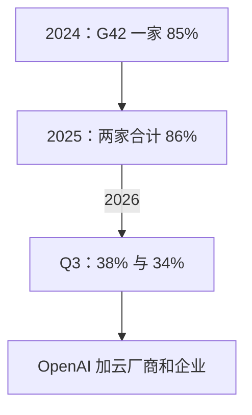

## Q
Cerebras 的客户集中度怎么变的？除了 OpenAI 还有哪些客户？

## A
- **2024 年**：G42（阿联酋的 AI 公司）一家占收入 85%。
- **2025 年**：MBZUAI 62% + G42 24% = 86%，两家是关联方。
- **2026 Q3**：一个客户占 38%（和另一客户关联），另一个占 34%。
- **变化**：从"几乎只有中东一家"变成"OpenAI 加一批云厂商和企业"，但仍然集中。

- **其他客户与伙伴**：
  - 模型公司：Meta（Llama API 的快速推理伙伴）、Mistral（Le Chat）。
  - 云与平台：AWS、IBM watsonx、Oracle（2027 年接入 OCI）、两家新的超大云厂商。
  - AI 原生公司：Cognition、Lovable。
  - 企业：Block、Figma、AlphaSense、GSK、CrowdStrike、Bilt。
- **为什么这些客户要速度**：AI 代理（自己连续调用模型干活的程序）和编程助手一次任务要生成成千上万个 token，速度决定用户等多久。
