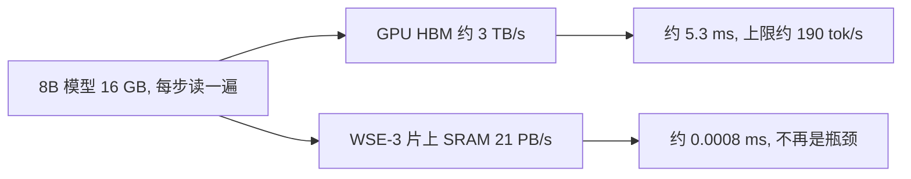

## Q
大语言模型生成回答时，为什么卡在内存带宽而不是算力？用一个 8B 模型手算一遍。

## A
- **生成是一个 token 一个 token 来的**：模型算出下一个 token，接到输入后面，再算下一个。
- **两个阶段**：
  - 预填充（prefill）：一次读完用户整段输入，计算量大，卡在算力。
  - 解码（decode）：逐个生成输出，**每一步都要把全部参数读一遍**。
- **手算**：8B 模型 = 80 亿个参数，每个 16 位（2 字节），共 **16 GB**。
  - 一块 GPU 的外挂内存 HBM 带宽约 3 TB/s：读一遍 16 GB 约 **5.3 ms** → 一个用户每秒最多约 **190** 个 token。
  - WSE-3 片上 SRAM 21 PB/s：读一遍约 0.0008 ms，不再是瓶颈。

- **对照**：Cerebras 2024 年在同样大小的 Llama 3.1 8B 上跑到 1,800 tok/s，超出 GPU 这条上限。
- **HBM（high-bandwidth memory）**：贴在 GPU 旁边的大容量内存；参数平时放在这里，每一步都要搬进芯片。
- **结论**：解码的速度上限 ≈ 内存带宽 ÷ 参数字节数。
