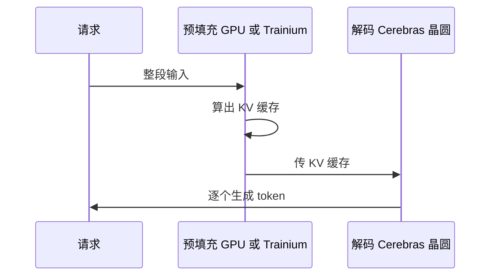

## Q
什么是分离式推理（disaggregated inference）？Cerebras 和谁合作做？为什么这么分？

## A
- **为什么分**：预填充（读完整段输入）卡在**算力**；解码（逐个生成）卡在**内存带宽**。两种工作适合不同的硬件。
- **怎么分**：
  - 预填充放在 GPU 或 AWS 的 Trainium 芯片上；
  - 解码放在 Cerebras 的晶圆上；
  - 中间把 KV 缓存（预填充算出的中间结果）从一边传到另一边。

- **合作方**：
  - **AWS**：Trainium 做预填充、CS-3 做解码，放进 AWS 自己的数据中心，通过 Amazon Bedrock 提供；AWS 是第一家把 Cerebras 放进自己机房的超大云厂商。
  - **AMD**：Helios 机柜（72 块 MI455X GPU）做预填充。
- **公司说法**：每个数据中心的 token 产出最多提高 5 倍（厂商说法）。
- **对测试的意义**：一个请求跨两种硬件、两套软件栈，KV 缓存在中间传输。版本、格式、超时任何一处不一致都会出错，这是典型的跨栈集成风险。
