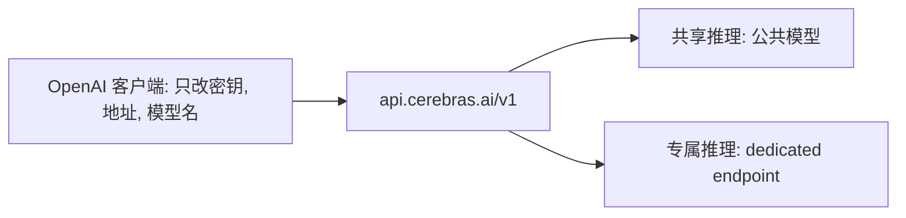

## Q
Cerebras 推理云怎么卖、API 长什么样？公开的速度是多少？

## A
- **API 与 OpenAI 兼容**：地址 `https://api.cerebras.ai/v1`。用 OpenAI 的客户端，只改密钥、地址和模型名就能调用。
- **支持**：
  - chat completions（对话接口：发一组消息，返回回答）；
  - 流式输出（streaming，回答一边生成一边推给客户端）；
  - 工具调用（tool calling，模型请求调用外部函数）；
  - 结构化输出（按给定 JSON 格式回答）。
- **两种卖法**：共享推理（公共模型，大家共用）和专属推理（dedicated endpoint，给一个客户单独部署）。

- **公开速度**（tok/s = 每秒生成的 token 数）：
  - `gpt-oss-120b` 约 3,000 tok/s；
  - OpenAI 的 GPT-5.6 Sol 750 tok/s；
  - Kimi K3.1（2.8 万亿参数）最高 2,000 tok/s。
- **量化说明**：共享推理只对权重做选择性量化（用更少的位数存参数），激活值、注意力和 KV 缓存保持全精度。
- **渠道**：自家云、AWS 与 Microsoft 应用市场、IBM watsonx、OpenRouter、Hugging Face，以及本地部署。
