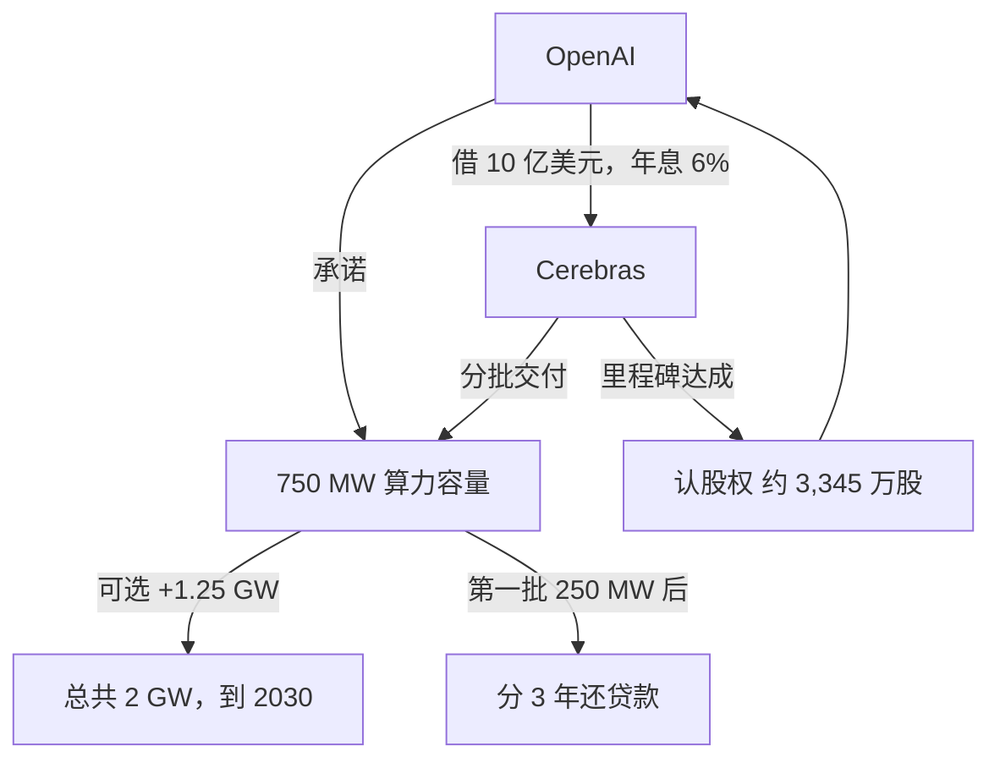

## Q
Cerebras 和 OpenAI 的合同主要条款是什么？

## A
| 条款 | 内容 |
|---|---|
| 时间 | 2025 年 12 月签，2026 年 1 月宣布 |
| 规模 | 承诺 **750 MW** 算力容量；可选再加 1.25 GW，总共 2 GW（到 2030 年底） |
| 价值 | 公司说**超过 200 亿美元** |
| 交付 | 分批交付，每个园区有最低容量；有物理与网络安全要求 |
| 违约 | 交付不达标或 SLA 不满足，OpenAI 可以终止 |
| 贷款 | OpenAI 借 10 亿美元营运资金，年息 6%，第一批 250 MW 交付后分 3 年还 |
| 认股权 | 约 3,345 万股，按贷款、市值、付款和交付里程碑归属 |
| 合作 | 共同设计未来模型；Codex-Spark（超过 1,000 tok/s）、GPT-5.6 Sol（750 tok/s）已上线 |

- **MW**：数据中心按耗电量算规模；用 MW 签说明卖的是"建好、插上电的容量"。
- **SLA（service-level agreement）**：服务水平承诺，比如可用性和延迟。
- 一句话："OpenAI committed 750 megawatts, valued at more than 20 billion dollars."
